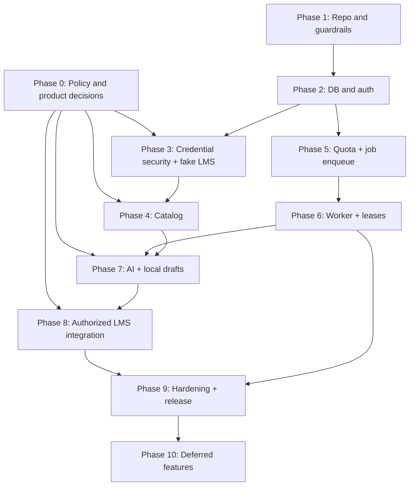

# Hallili — Implementation Plan

**Version:** v0.1  
**Status:** Proposed phased delivery plan

## 1. Delivery strategy

Build a narrow vertical slice, but establish the important boundaries first. Do not implement every infrastructure layer in isolation and do not build all UI pages before a working job can travel through the system.

The recommended first end-to-end slice is:

> Test-authenticated user → fake LMS catalog → create one job → PostgreSQL queue → Worker with fake AI → local draft saved → UI polls → user edits the local draft.

This proves the core architecture without depending on a live LMS, real student credentials, or external write permissions.

## 2. Critical pre-implementation gates

The following facts must be confirmed before enabling a real LMS integration or any real LMS mutation:

1. LMS/school authorization for the intended integration method and scope.
2. Whether an official API/documented method exists and should be preferred over page parsing.
3. Which data reads are allowed and whether draft-save operations are explicitly supported.
4. Stable LMS identifiers for subject, assessment, quiz, result/attempt, and question.
5. Cookie/session expiration, rotation, and concurrency behavior.
6. Academic-integrity rules for graded and timed assessments; a UI warning/opt-in does not establish permission.
7. AI data-processing policy: what question content may be sent to which provider, and retention settings.
8. Approved quota semantics and data-retention/account-deletion behavior.

Work that does not require these answers can proceed using fake adapters and fixtures. Do not let unknown external behavior block domain, UI, queue, database, or testing work.

## 3. Phases and exit criteria

### Phase 0 — Confirm scope and policy gates

**Goal:** Prevent implementation from depending on unverified LMS behavior or policy.

Tasks:
- Review `OPEN_DECISIONS.md` with the relevant stakeholders.
- Confirm permitted identity/account types.
- Confirm platform integration scope and available official interfaces.
- Decide whether timed assessments are outside v0.1 or allowed under a documented policy.
- Decide whether v0.1 supports local-only drafts or an approved LMS draft-save operation.
- Approve quota counting and retention rules.

**Exit criteria:** Decisions are recorded with evidence/owner/date; any unresolved LMS operation remains disabled behind a feature gate.

### Phase 1 — Repository foundation and architecture guardrails

**Goal:** Create the minimal workspace and make invalid dependency directions hard to introduce.

Tasks:
- Initialize pnpm workspace and Turborepo tasks.
- Create `apps/web` (TanStack Start) and `apps/worker` (Node process).
- Create minimal `domain`, `application`, `db`, `integrations`, and `contracts` packages only where needed.
- Add TypeScript, lint, formatting, and test configuration.
- Add architecture/dependency checks.
- Add environment schema validation and secret redaction utilities.
- Add local PostgreSQL Docker Compose service.

**Exit criteria:** Web and Worker start independently; CI runs typecheck/lint/unit tests; Domain has no infrastructure imports; Worker cannot import Submission.

### Phase 2 — Database schema and authentication

**Goal:** Establish persistence and a secure Hallili identity context.

Tasks:
- Pin compatible Better Auth/TanStack Start versions.
- Generate Better Auth schema/migrations using the supported workflow.
- Add initial Hallili migration tables and constraints.
- Configure Better Auth Microsoft provider after account/tenant policy is known.
- Add protected Server Route helper and `ActorContext`.
- Add user ownership tests and API error mapping.

**Exit criteria:** Test user can authenticate; protected routes return correct errors; migration runs on clean PostgreSQL; cross-user access tests fail safely.

### Phase 3 — LMS connection security and read-only adapter foundation

**Goal:** Build the integration boundary without connecting to a real account by default.

Tasks:
- Implement AES-256-GCM `CredentialCipher` and key-version/AAD handling.
- Implement `lms_connections` repository and save/revoke use cases.
- Implement API contracts for connection status/update/revoke.
- Build fake LMS adapter and sanitized fixtures.
- Implement allowlist/redirect/timeout/response-size enforcement in the adapter shell.
- Implement connection validation result mapping.

**Exit criteria:** Credential tests prove encryption/decryption and redaction; API never returns secret; fake adapter passes tests. Real LMS adapter remains disabled until Phase 0 gates pass.

### Phase 4 — Academic catalog

**Goal:** Normalize subjects and due assessments for the dashboard.

Tasks:
- Implement Subject and Assessment domain types.
- Implement Drizzle repositories and unique external-ID constraints.
- Implement catalog list and refresh use cases.
- Implement Zod DTOs and Server Routes.
- Add fake LMS fixtures for supported page shapes and parser mismatch tests.
- Derive UI status from source status plus Hallili job/draft state without conflating them.

**Exit criteria:** Dashboard lists fixtures correctly; duplicate sync upserts rather than duplicates; parser mismatch saves no guessed data; data is owner-scoped.

### Phase 5 — Quotas and durable job creation

**Goal:** Create durable, idempotent solve jobs quickly.

Tasks:
- Confirm quota semantics and configure policy.
- Implement quota buckets and idempotent usage events.
- Implement `solve_jobs` and active tuple partial unique index.
- Implement CreateSolveJobs use case with atomic quota reservation/job insert.
- Implement `POST /api/v1/jobs/solve` and job read/list contracts.
- Add `FOR UPDATE SKIP LOCKED` queue adapter and claim tests.

**Exit criteria:** Duplicate and concurrent requests create one active job per tuple; quota cannot oversubscribe; enqueue response meets the defined target in test environment; no AI call occurs in the request.

### Phase 6 — Worker runtime, leases, and recovery

**Goal:** Make background processing durable across restarts.

Tasks:
- Implement Worker entry point, polling loop, shutdown handling, and health status.
- Implement job leases/heartbeat and stale lease recovery.
- Implement per-LMS-connection account lease.
- Implement shared global LMS rate-limit state (configured conservatively; respects upstream blocks).
- Implement question-level checkpoints and sequential ordering.
- Use fake LMS/AI ports initially.

**Exit criteria:** Worker can be stopped/restarted; it reclaims eligible jobs; only one Worker owns a given job/connection lease; already durable questions are skipped.

### Phase 7 — AI generation and local draft review

**Goal:** Produce validated, reviewable local drafts.

Tasks:
- Implement `AiDraftGenerationPort` and one provider adapter behind configuration.
- Define versioned per-question output schemas based on supported fixtures.
- Implement bounded retry/fallback and `Retry-After` behavior.
- Implement answer validation against extracted allowed choices.
- Implement answer drafts, revisions, and optimistic edits.
- Implement review UI and progress polling.

**Exit criteria:** Fake provider and controlled provider tests pass; invalid/out-of-range output is rejected; local drafts persist; edit conflicts are handled; browser closure does not stop Worker.

### Phase 8 — Authorized LMS read integration and conditional draft persistence

**Goal:** Replace fake LMS adapter only after policy and protocol gates are satisfied.

Tasks:
- Implement only documented/approved read operations.
- Validate parser fixtures from a permitted test environment.
- Verify cookie rotation and account-level concurrency behavior.
- Keep remote draft saving disabled unless separately approved and semantically validated.
- If approved, implement narrowly scoped `LmsDraftPort`, reconciliation after ambiguous timeouts, and strict separation from final submission.

**Exit criteria:** Evidence of permission and documented protocol is recorded; parser reliability measured on an approved representative fixture set; explicit blocks are respected; remote draft-save behavior is tested without duplicate effects.

### Phase 9 — Hardening, performance, and release readiness

**Goal:** Verify NFRs, operational readiness, and safe failure behavior.

Tasks:
- Run security, API, DB concurrency, and E2E suites.
- Measure enqueue/status latency and ten-question workflow under a documented mock/provider profile.
- Verify extraction reliability using approved fixtures.
- Add Worker/Web health checks, structured logs, metrics, alerts, backup/restore validation.
- Confirm data retention, deletion, incident response, and secret rotation.
- Deploy Web and Worker separately with PostgreSQL and restricted secrets/DB roles.

**Exit criteria:** Release checklist signed off; no unresolved critical security/integrity issue; metrics are measured rather than assumed; rollback and restore procedures are tested.

### Phase 10 — Deferred product capabilities

Potential later work:
- BYOK and per-user encrypted AI keys.
- Notifications.
- richer history/export.
- approved final-action flow, only if separately authorized; never add it to Worker.
- v0.3 pre-indexed textbook context as defined by PRD.
- browser extension/native clients in later releases if product evidence justifies them.

## 4. Dependency overview

Some phases can overlap after their prerequisites are stable. For example, fixture-based Catalog work may proceed while external authorization is being reviewed, but real adapter activation cannot.

## 5. Vertical-slice recommendation

Do not wait until every module is complete. After Phase 6, deliver an internal slice with:

- test auth;
- fixture-backed catalog;
- one job creation;
- PostgreSQL queue and Worker;
- fake AI response;
- local draft persisted;
- TanStack Query progress display.

Then add pause/resume, real schema validation, and draft editing. This validates the system shape while the external integration gates remain isolated.

## 6. Global Definition of Done

A feature is complete only when:

- PRD requirement and acceptance criteria are linked;
- module ownership and dependency direction are respected;
- request/response or internal port contract is documented;
- migrations are included for schema changes;
- ownership and authorization are enforced server-side;
- happy path and relevant failure paths are tested;
- concurrency/idempotency implications are considered;
- secrets and sensitive data are redacted;
- logs and metrics permit diagnosis without exposing private data;
- docs and task status are updated;
- no external operation is enabled without its required gate.
