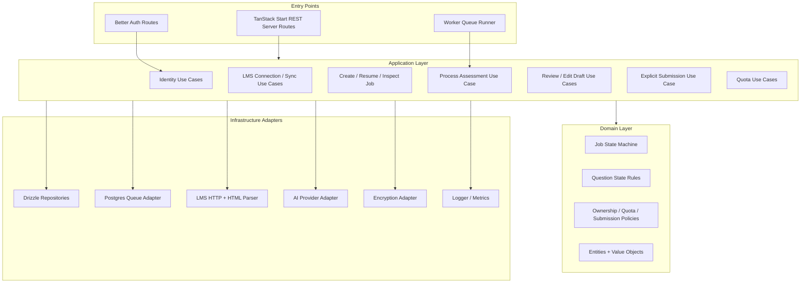
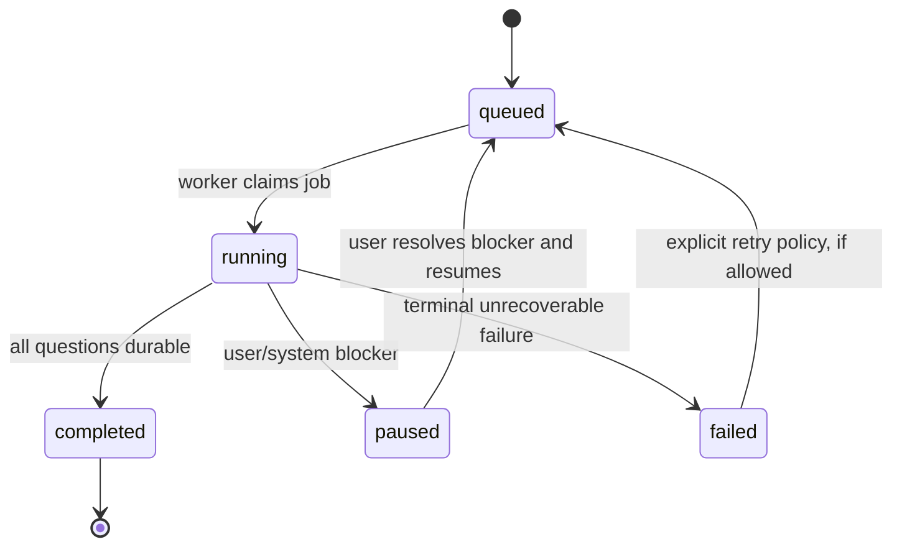

# Hallili — System Design v0.1

**Version:** 0.1  
**Based on:** Hallili PRD v0.1 (Approved Draft — Ready for System Design)  
**Status:** Architecture baseline for review and approval.

> This document translates the approved PRD into an implementable architecture. PRD-fixed constraints, discussion-selected choices, proposed implementation details, and externally controlled open questions are distinguished explicitly.

---

# 0. Executive Summary

## Proposed architecture

- **System style:** Modular Monolith.
- **Runtime topology:** TanStack Start Web Application + separate long-running Node.js Background Worker.
- **Internal code architecture:** Clean / Hexagonal Architecture (Ports & Adapters) applied pragmatically inside business modules.
- **Domain organization:** Feature/business-capability modules; light DDD, not full tactical DDD.
- **Repository:** Monorepo with pnpm Workspaces + Turborepo.
- **Persistence:** PostgreSQL + Drizzle ORM.
- **Queue:** PostgreSQL-backed queue using short transactions and `SELECT ... FOR UPDATE SKIP LOCKED`.
- **Client synchronization:** TanStack Query dynamic polling, fixed by the PRD.
- **Authentication:** Better Auth with Microsoft sign-in and its TanStack Start integration.
- **HTTP API:** TanStack Start Server Routes exposing versionable REST endpoints, validated using Zod.

## Core principle

TanStack Start is the **only HTTP backend**. It owns SSR, authentication routes, middleware, and the REST API. Requests enqueue work and return quickly; they never wait for AI inference or a complete LMS workflow. The Background Worker is a separate long-running process with no public business API. It claims durable jobs and invokes the same Application use cases directly. Therefore, the architecture has two process entry points but only one HTTP backend.

## What this architecture is not

- Not microservices.
- Not event sourcing.
- Not a distributed system with Redis/Kafka in v0.1.
- Not a headless browser per request.
- Not a collection of packages split into tiny abstractions without a concrete boundary.

---

# 1. Introduction & Goals

## 1.1 System purpose

Hallili is a responsive web platform for students in Qatar. It connects a student's authorized LMS session, presents enrolled subjects and due assessments, creates asynchronous work for preparing reviewable draft responses, and gives the student control over reviewing, editing, and any permitted final action.

The platform must preserve work across browser disconnections and safely handle expired sessions, parser mismatches, AI provider failures, and manual-input blockers.

## 1.2 Primary stakeholders

- Student: connects an account, browses assessments, monitors jobs, reviews and edits drafts.
- Hallili operator: manages service configuration, provider credentials, operational limits, and incidents.
- External systems: Microsoft identity provider, the LMS, and configured AI providers.

## 1.3 Architectural quality goals

| Priority | Quality attribute | Concrete interpretation |
|---|---|---|
| 1 | Security & privacy | Protect LMS session cookies, API keys, auth sessions, and student data. Enforce ownership on every read/write. |
| 1 | Reliability | Jobs survive browser closure and recover from worker restarts without duplicating completed question work. |
| 1 | Correctness | Validate extracted question structures and AI outputs; never guess values after parser mismatch. |
| 1 | Responsiveness | Job creation/status APIs do not wait for AI inference. Target enqueue response under 300ms under defined test conditions. |
| 1 | Isolation | One user's slow AI call must not block unrelated web requests or unrelated jobs. |
| 2 | Maintainability | Clear module ownership, dependency direction, tests around critical workflows, and documented decisions. |
| 2 | Evolvability | LMS and AI provider implementations can change behind interfaces without rewriting business rules. |
| 2 | Operability | Structured logs, metrics, health checks, retry diagnostics, and safe deployment/recovery procedures. |

## 1.4 Success metrics from the PRD

- Job enqueue latency: less than 300ms.
- Solving 10 questions: target less than 45 seconds, subject to a defined provider/network/test profile.
- Extraction reliability: at least 98%, measured against a defined set of supported LMS page structures and fixtures.

These are targets to validate, not guarantees architecture can promise without load tests and real provider measurements. Define percentile (for example p95), dataset, timeout, and workload before calling them achieved.

---

# 2. Constraints & Assumptions

## 2.1 Fixed constraints taken from PRD

1. Browser extension is out of v0.1.
2. Native mobile application is out of v0.1; web UI must be responsive.
3. Lesson/file context sync is deferred to v0.3.
4. Do not launch a full headless browser for every LMS request; prefer authorized direct HTTP requests and server-rendered HTML parsing.
5. PostgreSQL + Drizzle is the v0.1 queue foundation.
6. Queue operations sit behind an interface so a dedicated queue backend can be considered later.
7. TanStack Query dynamic polling is preferred over SSE for v0.1.
8. Microsoft sign-in via Better Auth.
9. Store the user's LMS session encrypted at rest; redact credentials from logs.
10. A background worker must not have access to the final-submission capability.

## 2.2 Assumptions that need validation

- The LMS integration is authorized by the platform's terms and the relevant school/guardian requirements. The design must not bypass access controls, WAF decisions, or published usage limits.
- The LMS's HTML and request/response behavior can be accessed through an approved integration path. If the platform provides an official API, that should take precedence over parsing private page internals.
- Microsoft accounts are the intended identity method for the target users; the allowed tenant/account types must be confirmed.
- The database is a managed or self-hosted PostgreSQL service with reliable transactions and connection pooling appropriate for a long-running worker.
- The v0.1 deployment has one or more web instances and one or more worker processes; the design must work with multiple workers, not rely on in-memory locks.

## 2.3 PRD decisions that are fixed for v0.1

The PRD explicitly resolves three architecture choices; they are constraints, not open questions:

1. **Queue:** PostgreSQL + Drizzle with `SELECT ... FOR UPDATE SKIP LOCKED`; isolate queue operations behind a port/adapter so BullMQ + Redis can be considered later without rewriting Worker business logic.
2. **Client synchronization:** TanStack Query dynamic `refetchInterval` while jobs are active, rather than SSE.
3. **v0.3 knowledge source:** Pre-uploaded/pre-indexed textbooks stored by Hallili and mapped to grade/section metadata; do not scrape lesson pages or LMS files.

## 2.4 Architecture drivers and decision sequence

Architecture choices should be derived in this order: PRD requirements → quality attributes → architectural drivers → system boundaries → runtime containers → components and dependency rules → runtime scenarios → data/API contracts → technology choices → validation tests. A technology is not a driver by itself; it is chosen because it satisfies a driver with acceptable complexity.

Key drivers are durable background execution, sub-300 ms enqueue/status responses, sequential per-attempt processing, safe resume, rotating LMS session cookies, global outbound rate control, strict credential protection, and maintainable provider/LMS boundaries. These drivers explain the Web/Worker split, PostgreSQL queue, state machines, shared locks, and adapter ports below.

## 2.5 Important PRD clarifications

- The PRD says requests to the LMS should be globally rate-limited and jittered to avoid overloading the external service. Treat this as **polite, documented rate limiting and load protection**, not a way to evade WAF or anti-abuse controls. Respect `429`, `403`, `Retry-After`, published policy, and any explicit block. Do not rotate IPs, disguise traffic, or bypass controls.
- Sequential execution per quiz attempt is specified, but rotating session cookies may be shared across several attempts for the same LMS account. Therefore, serialize access per LMS session/account as well, unless the LMS contract proves concurrent session use is safe.
- A network timeout after an external draft-save request creates an ambiguous outcome: the remote server may have saved the draft even when Hallili did not receive confirmation. Reconcile the remote state before retrying; do not blindly repeat non-idempotent side effects.
- `paused` needs a structured reason code, not only free-form error text.

---

# 3. Context & Scope — C4 Level 1

## 3.1 System context

```mermaid
flowchart LR
    Student[Student]
    Hallili[Hallili Platform]
    Microsoft[Microsoft Entra ID]
    LMS[Qatar Education LMS]
    AI[AI Provider(s)]
    Operator[Hallili Operator]

    Student <-->|Uses dashboard, reviews drafts| Hallili
    Hallili <-->|OAuth sign-in| Microsoft
    Hallili <-->|Authorized LMS requests| LMS
    Hallili <-->|Prompt / structured response| AI
    Operator -->|Configures providers, limits, operations| Hallili
```

## 3.2 External system boundaries

| External system | Why Hallili connects | Boundary / protection |
|---|---|---|
| Microsoft Entra ID | User authentication | OAuth/OIDC handled by Better Auth; validate issuer, audience, redirect URIs, and permitted tenant types. |
| LMS | Read subjects/assessments and perform only explicitly authorized draft/review actions | LMS Adapter, strict host allowlist, redirect re-validation, per-account session isolation, conservative rate limits. |
| AI provider(s) | Generate structured draft suggestions | Provider adapter, server-side credentials, schema validation, timeout/retry/fallback policy, no direct LMS tool access. |

## 3.3 In-scope for v0.1

- Microsoft sign-in and application sessions.
- Secure LMS session credential management.
- Subject and due-assessment discovery.
- Job creation, queueing, execution, progress, pause, and resume.
- Draft persistence and review/edit UI.
- Separate user-confirmed final action, only where permitted and explicitly enabled.
- Quota enforcement and essential history.

## 3.4 Out of scope for v0.1

- Browser extension and native apps.
- Automatic lesson/file scraping or textbook indexing.
- Microservices and Kubernetes.
- Redis/BullMQ before PostgreSQL queue limitations are demonstrated.
- Complex multi-tenant organization/teacher administration unless the product requirements later demand it.

---

# 4. Solution Strategy

## 4.1 Main architectural decision: Modular Monolith + separate Worker process

The business system stays a modular monolith: its modules are separated by business responsibility and dependency rules, not independently deployed services. The Web App and Worker are separate runtime processes because they have different workloads.

**One backend, two process entry points:** TanStack Start is the only HTTP backend and owns all browser-facing HTTP routes. The Worker is an internal queue consumer: it exposes no business API, has no second auth/API stack, and calls Application use cases directly. Therefore, `apps/api` and Hono are intentionally absent from the repository.

Why this is a fit:

- The Web App handles short-lived HTTP requests and rendering.
- The Worker handles long-running, retryable workflows.
- Both share the same application/domain code and data model.
- PostgreSQL is already required and can provide the initial queue.
- We avoid network calls between internal microservices and avoid operating Redis/Kafka prematurely.

## 4.2 HTTP backend boundary: TanStack Start only

TanStack Start owns the browser-facing HTTP surface: SSR, routing, Better Auth handlers, middleware, and REST Server Routes. The v0.1 REST API is implemented with Server Routes because the PRD describes HTTP endpoints and the client uses TanStack Query to poll them. Route loaders may call read use cases directly during SSR. Do not duplicate the same business operation through both a REST route and a Server Function.

Hono is not selected. A separate `apps/api` is not created. The Worker is not another backend: it has no public API and directly invokes Application use cases after claiming jobs from PostgreSQL.

## 4.3 Code architecture: Clean / Hexagonal, applied pragmatically

Each business module uses a dependency direction similar to:

```text
Entry points (TanStack Start Server Routes / Worker handlers)
                  |
                  v
          Application Use Cases
                  |
                  v
          Domain Model / Rules
                  ^
                  |
       Ports (interfaces) defined inward
                  ^
                  |
 Infrastructure Adapters (Drizzle, LMS HTTP, AI SDK, encryption)
```

Rules:

1. Domain code does not import TanStack Start, Drizzle, a provider SDK, or environment variables.
2. Application use cases depend on domain objects and interfaces (ports), not concrete vendors.
3. Infrastructure implements ports: repositories, queue storage, LMS client, AI provider, encryption, clock, and logging.
4. Web and Worker are composition roots: they construct dependencies and invoke use cases.
5. UI components do not query the database directly.
6. Avoid a generic repository abstraction for every table. Add interfaces where they protect a meaningful boundary or enable a real substitution/test seam.

## 4.4 Domain organization: feature modules / light DDD

Use business capabilities as module boundaries:

- Identity & Access
- LMS Connections
- Academic Catalog (subjects / assessments)
- Solving Jobs
- Draft Review
- Submission
- Usage & Quotas
- Notifications (minimal in v0.1)

Use a shared language in code and documents. Do not use `Quiz`, `Assessment`, `Attempt`, and `Job` interchangeably: define their meanings in the glossary.

## 4.5 Patterns used deliberately

| Pattern | Where | Why |
|---|---|---|
| Ports & Adapters | LMS, AI, repository, queue, encryption | Swap/test external implementations without changing use cases. |
| State Machine | Solve Job and Question Progress | Explicit allowed transitions; prevents invalid resume/complete behavior. |
| Adapter | LMS HTML/request format and AI provider SDKs | Isolate vendor/external contracts. |
| Strategy | AI model selection/fallback | Select provider/model based on configured policy. |
| Repository | Aggregate persistence where meaningful | Keep SQL/Drizzle out of application/domain rules. |
| Idempotency Key / Unique Constraint | Job creation, question result, confirmed action | Prevent duplicate work and repeated side effects. |

Do not add CQRS, Event Sourcing, Saga, or a general-purpose workflow engine in v0.1. The existing job state machine and transaction boundaries are enough until evidence says otherwise.

---

# 5. Container View — C4 Level 2

```mermaid
flowchart TB
    Browser[Student Browser]
    Web[Web Container\nTanStack Start\nUI + REST Server Routes]
    Worker[Worker Container\nNode.js process\nQueue Consumer + Job Orchestrator]
    DB[(PostgreSQL\nAuth + Domain + Queue + Drafts)]
    LMS[Qatar Education LMS]
    Microsoft[Microsoft Entra ID]
    AI[AI Provider(s)]
    Secret[Deployment Secret Store]

    Browser <-->|HTTPS / JSON| Web
    Web <-->|Read / write| DB
    Worker <-->|Claim jobs / persist progress| DB
    Web <-->|OAuth/OIDC| Microsoft
    Web -->|Enqueue / read / write| DB
    Web <-->|Read-only catalog / session validation| LMS
    Worker <-->|Authorized background reads / permitted draft operations| LMS
    Worker <-->|Structured generation requests| AI
    Web -.->|Runtime secrets| Secret
    Worker -.->|Runtime secrets| Secret
```

## 5.1 Container responsibilities

### A. Web Application

- TanStack Start (React + TanStack Router).
- SSR and route loaders for page composition and initial data reads; client components only where interaction/state is needed.
- TanStack Start Server Routes form the single REST API boundary. Route loaders can invoke read use cases during SSR. Do not duplicate the same business operation through Server Functions; use those only if a future ADR identifies a distinct same-origin RPC need.
- Better Auth routes and session validation, mounted through TanStack Start server routing (for example, `/api/auth/$`); use the official TanStack Start cookie integration where required.
- TanStack Query for client cache and active job polling.
- No LLM inference or multi-question LMS workflow inside the request lifecycle.

### B. Background Worker

- Long-running Node.js process, not a TanStack Start route, not a serverless request function, and not an in-memory browser task.
- Polls and claims jobs from PostgreSQL.
- Uses a durable lease/heartbeat to recover from worker crashes.
- Processes questions sequentially within the required account/attempt lock scope.
- Persists progress after each durable step.
- Uses provider adapters and LMS adapter.
- Does not import or receive the final submission port/capability.

### C. PostgreSQL

Stores:

- Better Auth tables.
- User/LMS connection metadata and encrypted session data.
- Subjects, assessments, attempts.
- Solve jobs and per-question progress.
- Draft responses and review edits.
- Quota/usage events and audit records.

The same database is used by Web and Worker, but all critical changes go through application use cases and repository/queue adapters.

---

# 6. Component / Building Block View — C4 Level 3

## 6.1 Backend component groups



The diagram is a responsibility map, not permission for every application use case to call every adapter. Each use case receives only the ports it needs.

## 6.2 Suggested module map

| Module | Owns | Must not own |
|---|---|---|
| Identity | User identity, auth session integration, user access context | LMS cookies or solving logic |
| LMS Connections | Encrypted LMS credentials, validation, rotation metadata, account lock | AI generation |
| Catalog | Subject and assessment snapshots, sync timestamps, external IDs | Job execution |
| Solving | Job lifecycle, question order/progress, retry/pause/resume policy | UI rendering |
| Draft Review | Draft versions, user edits, review state | Queue claiming |
| Submission | Explicit user confirmation and submission result | Background solving permissions |
| Usage | Quota checks/reservations/usage ledger | AI provider implementation |
| Notifications | Completion notification delivery | Job state ownership |

## 6.3 LMS integration boundary

The LMS adapter should expose narrow, typed operations such as:

- Fetch the current user's subjects.
- Fetch due assessments for a subject.
- Fetch a particular authorized assessment attempt/question page.
- Validate the current session.
- Save or reconcile a draft only if the platform's rules and integration contract permit it.

Implementation notes:

- Use a strict hostname allowlist and HTTPS.
- Re-check the hostname on every redirect; never forward cookies to an unapproved host.
- Do not accept an arbitrary URL from the browser or LLM.
- Apply request timeouts, size limits, parsing limits, and conservative shared rate limiting.
- Stop and surface an actionable error on access denial, explicit block, or unexpected redirect.
- Store parser fixtures for supported HTML structures; a parser mismatch is a pause/error, never a guess.
- Treat LMS page text as untrusted input. It must not become executable instructions or grant the AI agent tools/network access.

## 6.4 AI integration boundary

Application code should depend on an interface like `DraftGenerationPort`, not directly on a specific provider SDK.

Adapter responsibilities:

- Provider/model selection from server-managed configuration.
- Timeout and retry classification.
- Fallback selection only for eligible transient failures.
- Structured output parsing and schema validation.
- Logging provider/model/request metadata without prompts or secrets by default.
- BYOK handling only if the feature is enabled and the key is encrypted and scoped to the user.

Validation responsibilities should remain outside the model:

- Validate the response schema.
- Validate option values against the extracted allowed values.
- Reject missing/out-of-range values.
- Store confidence and explanation as model-provided metadata, not as proof of correctness.

---

# 7. Runtime View — Critical Scenarios

## 7.1 Scenario A: Create a solving job

```mermaid
sequenceDiagram
    actor Student
    participant Browser
    participant Web as TanStack Start Server Route
    participant App as Create Job Use Case
    participant DB as PostgreSQL
    participant Worker

    Student->>Browser: Select assessment(s)
    Browser->>Web: POST /api/jobs/solve
    Web->>App: Authenticate + authorize + validate + reserve quota
    App->>DB: Insert job rows + quota reservations in one transaction
    DB-->>App: Job ID + queued status
    App-->>Web: Job receipt
    Web-->>Browser: 202 Accepted + job ID
    Note over Web,Worker: Worker claims asynchronously; HTTP request does not wait for AI.
    Worker->>DB: Claim queued job using short SKIP LOCKED transaction
```

Important: create the job row and its initial question rows in one transaction. Because the job table itself is the queue, there is no separate broker publish that can be lost after a database commit.

## 7.2 Scenario B: Worker claims and processes a job

```mermaid
sequenceDiagram
    participant Worker
    participant Queue as Queue Adapter
    participant DB as PostgreSQL
    participant LMS as LMS Adapter
    participant AI as AI Adapter

    Worker->>Queue: claimNextJob()
    Queue->>DB: BEGIN; SELECT ... FOR UPDATE SKIP LOCKED
    Queue->>DB: Set status=running, lease, heartbeat, attempts
    Queue->>DB: COMMIT
    Worker->>DB: Load job + pending questions
    loop Each pending question, sequentially
      Worker->>DB: Check question state (skip already durable)
      Worker->>LMS: Fetch authorized question data
      LMS-->>Worker: Parsed/normalized question
      Worker->>AI: Generate structured draft
      AI-->>Worker: Candidate response
      Worker->>Worker: Validate schema + allowed values
      Worker->>LMS: Save draft only if permitted
      LMS-->>Worker: Save acknowledgement / reconciliation result
      Worker->>DB: Persist draft + question status + job progress
    end
    Worker->>DB: Mark job completed or paused/failed
```

Do not keep a PostgreSQL transaction open during an LMS or AI network call. Claim/lease quickly, commit, perform network work, then persist the result in a separate short transaction.

## 7.3 Scenario C: Pause and resume

1. Worker detects a known blocker (for example `SESSION_EXPIRED`, `MANUAL_INPUT_REQUIRED`, `PARSER_MISMATCH`, or a non-recoverable provider/configuration condition).
2. Worker persists the completed question result before pausing.
3. Worker transitions the job to `paused` with a typed `pause_reason` and safe user-facing message.
4. User resolves the blocker (updates session or supplies the required manual input).
5. User explicitly requests resume.
6. Application use case validates ownership, blocker resolution, and quota rules, then sets the job back to `queued` (or an equivalent ready state).
7. Worker reclaims it, skips durable completed questions, rechecks the blocker, and continues.

Never implement resume as “set status to running from the browser.” The Worker owns execution; the application controls a legal transition back to the queue.

## 7.4 Scenario D: UI progress synchronization

- The dashboard initially loads through TanStack Start SSR/route loaders or an authenticated read endpoint.
- A client query reads `/api/jobs/:jobId`.
- TanStack Query polls while the job is `queued` or `running`.
- Polling slows or stops when the job becomes `paused`, `completed`, or `failed` depending on the screen's needs.
- The API returns only the user's own job and sanitized status data.
- Do not expose raw LMS HTML, cookies, CSRF tokens, internal provider errors, or secret-bearing diagnostics.

## 7.5 Scenario E: Explicit final action

The final action is a distinct capability:

- A dedicated user-facing use case and endpoint.
- Fresh authentication/authorization and ownership check.
- A clear confirmation step and an idempotency key.
- A dedicated submission adapter/port that is not injected into the background Worker.
- Audit record of who confirmed, when, which attempt, and the result.
- Worker role/service configuration must not possess the submission capability or required secret/permission.

Whether this operation should exist at all must be validated against LMS and school rules. A UI confirmation alone is not a substitute for authorization.

---

# 8. Job State Machine & Queue Design

## 8.1 Job state model



Do not allow arbitrary status updates. Centralize transitions in domain methods/use cases and test the transition table.

## 8.2 Suggested status fields

- `status`: `queued | running | paused | completed | failed`
- `pause_reason`: enum, e.g. `SESSION_EXPIRED`, `MANUAL_INPUT_REQUIRED`, `PARSER_MISMATCH`, `POLICY_BLOCKED`, `PROVIDER_UNAVAILABLE`.
- `last_error_code`: stable internal code, not raw provider output.
- `current_question_index`, `total_questions`, `completed_questions`.
- `attempt_count`, `available_at`.
- `locked_by`, `lease_expires_at`, `heartbeat_at`.
- `started_at`, `finished_at`, `created_at`, `updated_at`.

## 8.3 Claiming jobs safely

A worker claim should be a short transaction:

1. Select one eligible queued job (or a job with an expired lease) ordered by priority/creation time.
2. Use `FOR UPDATE SKIP LOCKED` so multiple workers do not claim the same row.
3. Update status/lease/heartbeat/attempt count.
4. Commit.
5. Process outside the transaction.

The worker periodically extends its lease. If the worker crashes, another worker can reclaim the job after the lease expires. The lease duration and heartbeat cadence must be tuned and monitored.

## 8.4 Idempotency requirements

- Job creation: unique active job for the PRD tuple `(user_id, quiz_id, results_id)`; use a partial unique index for active states or an equivalent transaction-safe idempotency record.
- Per-question work: unique `(job_id, external_question_id)` and unique draft-result ownership.
- Persist the external LMS draft acknowledgement and local state carefully.
- On an ambiguous external timeout, read/reconcile remote state before retrying a write.
- Resume must never re-run questions already marked durably complete unless an explicit user-requested reprocessing workflow exists.

## 8.5 Concurrency policy

At minimum:

- Sequential question processing inside one assessment attempt.
- A distributed per-LMS-account/session lease if session cookies rotate and are shared between jobs.
- A global LMS outbound rate limiter shared across all worker instances.
- A separate concurrency limit for AI requests so slow provider calls cannot exhaust worker resources.

These controls must be database/distributed coordination mechanisms, not in-memory maps that fail when the Worker scales to multiple processes.

---

# 9. Data Architecture

## 9.1 Proposed logical entities

Names are tentative; finalize them after reviewing the actual LMS data model.

| Entity/table | Purpose | Important relationships/constraints |
|---|---|---|
| `user` / Better Auth tables | Application identity and sessions | Owned by Better Auth schema/migrations. |
| `lms_connections` | One user's LMS connection/session metadata | `user_id`, encrypted cookie fields, key version, validation/expiry timestamps. |
| `subjects` | Normalized subject snapshots | Scoped to LMS connection/user; external subject ID. |
| `assessments` | Due assessment metadata | Belongs to subject; external assessment ID and due/status fields. |
| `assessment_attempts` | A student's specific LMS attempt/result context | External quiz/result IDs; belongs to assessment. |
| `solve_jobs` | Durable background job queue + lifecycle | Owner, attempt, status, lease, idempotency fields. |
| `job_questions` | Ordered question-level execution | Unique job/question identity, status, parser snapshot/version where useful. |
| `answer_drafts` | Generated and edited draft versions | Belongs to a job question; version history if audit/edit history is required. |
| `usage_ledger` | Quota reservations and finalized usage | Idempotent usage event keys; prevents double charging. |
| `audit_events` | Sensitive/security-relevant actions | Actor, action, target, timestamp, sanitized metadata. |
| `notifications` | In-app notifications (if enabled) | User-owned notification state. |
| `submission_records` | Explicitly confirmed final actions (if permitted) | Idempotency key, actor, time, result and audit references. |

## 9.2 Key relational rules

- Every user-owned row must be scoped by user/connection ownership and checked in the application layer.
- Add database foreign keys and unique constraints for invariants that should survive application bugs.
- Index common lookups: jobs by `(user_id, created_at)`, queue eligibility by `(status, available_at)`, job questions by `(job_id, sequence)`, assessments by `(subject_id, due_at)`.
- Add a partial unique index for the active-job tuple if the chosen PostgreSQL constraint design permits it.
- Use migrations checked into source control; do not rely on manual production schema edits.
- Decide retention/deletion rules for cookies, raw extracted snapshots, prompts, AI output, audit events, and history before launch.

## 9.3 LMS cookie encryption

Use authenticated encryption (AES-256-GCM as the PRD specifies) with:

- A random unique nonce/IV for each encryption operation.
- Authentication tag stored alongside ciphertext (or included in the encoded payload).
- Key material supplied through a deployment secret manager, not stored in the same database as ciphertext.
- A `key_version` field to support rotation.
- Associated authenticated data (AAD), such as connection ID and user ID, to bind ciphertext to its owner.
- Encryption/decryption only in a narrow server-side adapter; decrypted values exist in memory only as long as required.
- No cookie values in logs, traces, exception messages, analytics, URLs, or browser storage.
- Explicit revoke/delete and key-rotation procedures.

The exact cookie scope, expiry detection, `Set-Cookie` parsing and re-encryption behavior require tests against the permitted LMS integration contract.

---

# 10. API Design

Use versionable REST resource endpoints and validate every request/response shape with Zod. The names below are illustrative, not yet an OpenAPI contract.

| Method | Endpoint | Purpose |
|---|---|---|
| `GET` | `/api/subjects` | List the authenticated user's subjects. |
| `GET` | `/api/assessments?due=...` | List due assessments with filters. |
| `PUT` | `/api/lms-connection` | Create/update the user's encrypted LMS session. |
| `POST` | `/api/lms-connection/validate` | Validate the current connection. |
| `DELETE` | `/api/lms-connection` | Revoke/delete stored session data. |
| `POST` | `/api/jobs/solve` | Create one or more jobs; return `202 Accepted` and job IDs. |
| `GET` | `/api/jobs/:jobId` | Read sanitized progress/status. |
| `POST` | `/api/jobs/:jobId/resume` | Explicitly resume a paused job. |
| `GET` | `/api/jobs/:jobId/questions` | Read question progress and draft references. |
| `PATCH` | `/api/drafts/:draftId` | Save a user's edit. |
| `POST` | `/api/attempts/:attemptId/confirm-submission` | Explicit confirmation boundary, only if permitted. |

## 10.1 API response principles

- Return `202 Accepted` for asynchronous work creation.
- Include a stable job ID and current status.
- Use consistent error objects with stable error codes.
- Do not leak whether another user's job exists; return an appropriate not-found response for unauthorized ownership.
- Enforce rate limits and request body limits.
- Never accept raw external URLs as fetch targets.
- Do not return secret values, raw cookies, CSRF tokens, or unredacted LMS/provider errors.

---

# 11. Repository / Monorepo Design

## 11.1 Why a monorepo

The Web App and Worker need to evolve together and share domain rules, application use cases, database types, and contracts. A monorepo keeps atomic changes possible while allowing separate builds and deployments.

**pnpm Workspaces** defines and links the local packages. **Turborepo** runs the package task graph, parallelizes tasks where possible, and caches safe build/test outputs. Turborepo is tooling; it is not the system's runtime architecture.

## 11.2 Proposed directory structure

```text
hallili/
├── apps/
│   ├── web/                         # TanStack Start: UI + only HTTP backend
│   │   └── src/
│   │       ├── routes/              # File routes, loaders, REST Server Routes
│   │       ├── features/            # UI feature composition
│   │       ├── components/          # App-specific UI components
│   │       └── server/
│   │           ├── composition/    # Dependency wiring
│   │           ├── middleware/     # Request context / security / logging
│   │           └── auth/           # Better Auth configuration
│   │
│   └── worker/                      # Long-running Node.js process
│       └── src/
│           ├── main.ts              # Composition root / process entry
│           ├── runtime/             # Polling, signals, health
│           ├── handlers/            # Queue job handlers
│           └── observability/       # Worker-specific telemetry
│
├── packages/
│   ├── domain/                      # Entities, value objects, state machines
│   │   └── src/
│   │       ├── identity/
│   │       ├── lms/
│   │       ├── catalog/
│   │       ├── solving/
│   │       ├── drafts/
│   │       └── usage/
│   │
│   ├── application/                 # Use cases + ports/interfaces
│   │   └── src/
│   │       ├── lms/
│   │       ├── catalog/
│   │       ├── solving/
│   │       ├── drafts/
│   │       ├── submission/
│   │       └── usage/
│   │
│   ├── db/                          # Drizzle schema, migrations, DB adapters
│   │   └── src/
│   │       ├── schema/
│   │       ├── migrations/
│   │       ├── repositories/
│   │       └── queue/
│   │
│   ├── integrations/                # External adapters
│   │   └── src/
│   │       ├── lms/
│   │       ├── ai/
│   │       └── encryption/
│   │
│   ├── contracts/                   # Zod API schemas + shared DTOs
│   │   └── src/
│   │
│   └── config/                      # Shared TS/ESLint/Prettier config
│
├── docs/
│   └── architecture/
│       ├── system-design.md
│       ├── diagrams/
│       └── adr/
│
├── infra/
│   ├── docker/
│   └── compose.yaml
│
├── pnpm-workspace.yaml
├── turbo.json
├── package.json
├── pnpm-lock.yaml
└── README.md
```

Do not create every package directory on day one. Establish the dependency boundaries first, then extract a package when it has a clear owner and at least two meaningful consumers or a real independent responsibility.

## 11.3 Dependency direction

```text
apps/web    ─────┐
                ├──> packages/application ───> packages/domain
apps/worker ─────┘             |
                              | depends on ports
                              v
                    packages/db / integrations

apps/web ─────> packages/contracts
```

More precisely:

- `domain` imports no internal package and no infrastructure framework.
- `application` may import `domain`; it defines ports for persistence and external operations.
- `db` and `integrations` implement those ports; they may import `application` port types and `domain` types.
- `web` and `worker` wire concrete adapters into application use cases.
- `contracts` contains transport schemas/DTOs; avoid letting database models leak into the browser.
- Do not introduce dependency cycles. Use `workspace:*` for local package dependencies.

---

# 12. Technology Decisions & Alternatives

| Area | v0.1 choice | Why | Revisit when |
|---|---|---|---|
| Web | TanStack Start (React + TanStack Router) | One full-stack React framework provides SSR, typed routing, middleware, and Server Routes. | A strong product or deployment constraint favors another framework. |
| UI | React + Tailwind CSS + shadcn/ui | Matches the current UI stack and supports responsive feature composition. | Revisit only if product UI needs materially change. |
| Worker | Node.js + TypeScript process | Long-running independent process with shared TypeScript code. | Worker CPU/memory profile or language-specific tooling requires another runtime. |
| Auth | Better Auth + Microsoft | Directly matches PRD. | Account policy/tenant requirements or provider support changes. |
| DB | PostgreSQL + Drizzle | Relational model, transactions, constraints, queue support. | Data volume/operational measurements justify another store. |
| Queue | PostgreSQL queue | Already using PostgreSQL; simple v0.1 operations and easy transaction boundary. | Queue throughput, scheduling, visibility, or operational load becomes a demonstrated bottleneck. |
| Cache/polling | TanStack Query | Matches PRD; dynamic polling can stop after terminal states. | Need lower-latency updates at substantial scale; then reassess SSE/WebSockets. |
| Monorepo | pnpm + Turborepo | Shared packages with ordered/cached tasks. | Repo is tiny enough that Turbo provides no practical value (pnpm workspace can remain). |
| API | TanStack Start Server Routes + REST + Zod | One HTTP backend and explicit endpoints; aligns with the PRD and TanStack Query polling. Do not add Hono or a separate `apps/api`. | A separately consumed API or proven transport requirement justifies a new ADR. |
| AI | Provider port + adapters | Fallback/BYOK without vendor lock-in in business rules. | Choose a specific SDK after model/provider requirements are proven. |
| Browser automation | None by default | PRD says SSR HTML fetch/parse; lower runtime cost and operational risk. | Only if an authorized workflow genuinely requires browser execution and is isolated. |

## 12.1 Queue implementation notes

`SKIP LOCKED` is appropriate for queue-like consumers, but it is not a complete queue system by itself. We still need:

- claim transactions;
- worker leases/heartbeats;
- stale-job recovery;
- retry scheduling and maximum attempts;
- idempotency constraints;
- concurrency/priority policy;
- monitoring for oldest queued job and stuck leases.

Do not hold a row lock or database transaction for the entire duration of a model call.

## 12.2 Deployment recommendation

Local development:

- `apps/web` and `apps/worker` run as separate processes.
- PostgreSQL runs through Docker Compose.
- Use a fake/mock LMS adapter and fake AI adapter in most automated tests.

Production v0.1:

- Deploy Web and Worker as separate containers/processes.
- Use managed PostgreSQL or a properly operated PostgreSQL instance.
- Put a reverse proxy/CDN in front of the web service where appropriate.
- Keep secrets in the deployment secret store.
- Start with one Worker process if usage is low; increase replicas only after queue and per-account locking are safe across processes.
- Deploy TanStack Start as a Node.js server/container. The Worker must run as a separate persistent Node.js process/container; both may run on the same VPS. Do not deploy the Worker as a short-lived serverless request function.

---

# 13. Security, Privacy & Failure Handling

## 13.1 Security boundaries

- Authentication is not authorization: every resource lookup/mutation must enforce owner and scope.
- Enforce least privilege between Web, Worker, database credentials, and external integration capabilities.
- The Worker should not receive the final-submission adapter or credentials. Prefer separate database roles for Web and Worker; the Worker role should lack permission to write submission records or invoke any final-action mechanism. Application-level dependency boundaries and database privileges should reinforce each other.
- Limit outbound requests to fixed allowed hosts; validate redirects on every hop.
- Never accept an arbitrary URL from a user, assessment HTML, or model output.
- Protect cookies and BYOK keys with authenticated encryption; key material remains outside the database.
- Redact or omit cookies, CSRF/authenticity tokens, API keys, OAuth tokens, and sensitive question content from logs.
- Use CSRF protections where cookie-authenticated browser mutations require them; validate origin/content type as part of the API security design.
- Apply request payload, response body, time, and concurrency limits.
- Treat LMS page content as untrusted data, not instructions for the AI system.

## 13.2 Failure matrix

| Failure | Expected behavior |
|---|---|
| LMS session expired | Pause with `SESSION_EXPIRED`; preserve durable work; request revalidation/update. |
| Parser structure changed | Pause with `PARSER_MISMATCH`; capture sanitized diagnostics/fixture; never guess an answer or option. |
| AI `429`/`503` | Respect `Retry-After` and bounded exponential backoff; switch fallback only under configured policy. |
| AI invalid JSON/schema | Reject in validator; at most a bounded correction attempt; otherwise pause/fail safely. |
| Worker crashes | Lease expires; another Worker reclaims; completed question records are skipped. |
| Browser closes | Worker continues independently; state remains in DB. |
| Duplicate job request | Return existing active job or safely reject according to idempotency policy. |
| External write timed out | Reconcile remote draft state before retrying; do not assume it failed. |
| LMS returns `403` / explicit anti-automation block | Stop the integration and surface the block; do not bypass it. |
| Database temporarily unavailable | Stop claiming new jobs; bounded retry with backoff; health status becomes degraded. |

## 13.3 Observability

Structured logs should include:

- `request_id`, `job_id`, `user_id` (internal identifier only), `worker_id`, `attempt_number`;
- module/operation and stable error code;
- duration, retry count, provider name/model alias, and outcome.

Do not include raw session cookies, tokens, API keys, full request headers, or unredacted page contents.

Track metrics such as:

- enqueue latency;
- queue depth and oldest queued job age;
- job duration and outcome by error code;
- question processing duration;
- lease expirations/stuck jobs;
- LMS response status and latency;
- AI rate-limit/failure rate;
- parser success/mismatch rate;
- active jobs per account and global outbound request rate.

Add health endpoints/checks for Web and Worker separately. A web process being healthy does not mean the Worker is consuming jobs.

---

# 14. Testing Strategy

| Level | What to test | Suggested tooling |
|---|---|---|
| Unit | Domain transitions, quota rules, validation, retry policy, idempotency policy | Vitest |
| Application tests | Use cases with fake repositories/ports | Vitest |
| DB integration | Transactions, unique constraints, queue claiming with concurrent workers, lease recovery | Vitest + real PostgreSQL test database/container |
| LMS adapter tests | HTML fixtures, redirects, status mapping, timeout and parser mismatch cases | Vitest + fixture files + mock HTTP server |
| AI adapter tests | Valid/invalid structured outputs, 429/503, timeout, fallback policy | Vitest + mocked provider |
| API integration | Auth, ownership isolation, validation, error contracts | Vitest / API test harness |
| E2E | Login flow where feasible, dashboard, job progress, pause/resume, draft edit, explicit confirmation boundary | Playwright |
| Security tests | Cross-user access, token redaction, redirect allowlist, forbidden worker capability | Automated integration/security tests |

Critical test scenarios:

1. Two workers attempt to claim the same job: only one succeeds.
2. Worker crashes after question 4: restart does not duplicate durable questions 1–4.
3. Two jobs share one rotating LMS session: account-level serialization prevents cookie race conditions.
4. A user requests another user's job ID: no data leaks.
5. Parser receives an unknown option structure: no guessed value is persisted.
6. Worker cannot import or call the final submission capability.
7. Duplicate create-job requests produce one active job for the idempotency tuple.

---

# 15. Development & Delivery Approach

## 15.1 Architecture-first workflow

For each feature, move through a repeatable chain before substantial coding:

1. Reference the PRD requirement and write acceptance criteria.
2. Define the actor, user flow, preconditions, and failure paths.
3. Identify ownership and authorization rules.
4. Define the Application use case and Domain invariants.
5. Identify the required ports and concrete adapters.
6. Define data changes, uniqueness constraints, idempotency keys, and transaction boundaries.
7. Define the Server Route contract, Zod input/output, HTTP statuses, and error codes.
8. Add or update runtime/state diagrams for critical flows.
9. Define unit, integration, failure, and E2E tests.
10. Update traceability and ADRs when the design changes.

When using AI coding tools, provide the exact requirement, relevant module boundaries, allowed dependencies, acceptance tests, and explicit non-goals (for example: do not add another backend, do not bypass application ports, and do not call an AI/LMS provider directly from a route). The implementation agent should execute the design, not silently redefine it.

## 15.2 How we should build it

Build vertical slices around the highest-risk workflows. Do not build every database table, every UI page, and every adapter independently before integrating them.

Suggested order:

1. **Architecture skeleton:** workspace, Web app, Worker process, configs, DB connection, CI checks, docs.
2. **Identity:** Better Auth + Microsoft sign-in + ownership tests.
3. **LMS connection security:** encryption, update/revoke/validate, redaction.
4. **Read-only LMS integration:** subjects and due assessments, parser fixtures, rate limits, error handling.
5. **Queue foundation:** create job, claim/lease/heartbeat, status endpoint, worker shutdown/recovery.
6. **Question-level workflow:** sequential execution, persistence, idempotency, pause reasons.
7. **AI adapter:** structured output, schema validation, bounded retries/fallback.
8. **Draft saving and review:** editable draft lifecycle, audit trail.
9. **Explicit final action:** only after policy and LMS contract validation, in an isolated capability.
10. **Hardening:** concurrency tests, load tests, observability, deployment/recovery docs.

## 15.3 Definition of done for an architectural slice

- The requirement and the architectural decision are documented.
- The application use case and its permission checks exist.
- The happy path and at least one failure path are tested.
- Persistence/transaction boundaries are explicit.
- Logs are sanitized.
- No layer boundary is bypassed just to make the feature work quickly.
- The relevant diagram/ADR is updated when the design changes.

---

# 16. arc42 Documentation Map

Use arc42 as the document structure and C4 as the diagramming model. They complement each other: arc42 organizes the architecture knowledge; C4 gives the system diagrams at different zoom levels.

| arc42 section | Hallili content to document | Current location in this proposal |
|---|---|---|
| 1. Introduction & Goals | Purpose, users, quality goals | Sections 1–2 |
| 2. Architecture Constraints | PRD constraints, platform limitations, policies | Section 2 |
| 3. Context & Scope | Actors, external systems, scope | Section 3 |
| 4. Solution Strategy | Modular Monolith, Worker, Clean/Hexagonal | Section 4 |
| 5. Building Block View | Containers, modules, dependencies | Sections 5–6, 11 |
| 6. Runtime View | Enqueue, solving, resume, polling, confirmation | Section 7 |
| 7. Deployment View | Web/Worker/DB deployment and environments | Section 12.2 |
| 8. Crosscutting Concepts | Security, errors, logging, data, testing | Sections 9, 13, 14 |
| 9. Architecture Decisions | ADR records and rationale | Section 17 |
| 10. Quality Requirements | measurable performance/reliability scenarios | Section 1.3–1.4 |
| 11. Risks & Technical Debt | unresolved integrations, queue, parser and policy risks | Sections 2, 13, 18 |
| 12. Glossary | domain vocabulary | Section 19 |

---

# 17. Architecture Decision Records (ADR)

The ADR statuses distinguish PRD-fixed decisions, discussion-selected choices, and remaining proposals. “Accepted for baseline” means selected for this design version; validate implementation details before coding.

## ADR-001 — Modular Monolith with a separate Worker

**Status:** Accepted for baseline  
**Decision:** Keep one business system and shared codebase; TanStack Start is the only HTTP backend; run the Worker as a separate process with no public business API.  
**Reason:** Separates short HTTP requests from long-running jobs while avoiding premature microservices.  
**Consequences:** Shared packages and DB; separate deployment/health/lifecycle; strict module boundaries needed.

## ADR-002 — TanStack Start as the only HTTP backend

**Status:** Discussion-selected / accepted for baseline  
**Decision:** TanStack Start owns the UI, SSR, middleware, authentication routes, and REST Server Routes. Do not add Hono or a separate `apps/api` in v0.1.  
**Reason:** The product needs one HTTP backend. Start provides the required web and server-route capabilities, while the Worker does not require an HTTP API.  
**Consequences:** Keep routes thin; move business logic into shared Application/Domain packages; the Worker invokes use cases directly.

## ADR-003 — PostgreSQL-backed job queue

**Status:** PRD-fixed / accepted for baseline  
**Decision:** Use PostgreSQL queue rows claimed with `FOR UPDATE SKIP LOCKED`.  
**Reason:** Existing DB, simple operations in v0.1, transactional enqueue.  
**Consequences:** Must build lease recovery, retry scheduling, idempotency and monitoring; no long transaction across network calls.

## ADR-004 — TanStack Query dynamic polling

**Status:** PRD-fixed / accepted for baseline  
**Decision:** Poll while a job is `queued` or `running`; stop or slow polling after `paused`, `completed`, or `failed` according to the UI policy.  
**Reason:** Simpler than SSE for v0.1.  
**Consequences:** Polling frequency must be tuned to avoid excessive load; status API must remain lightweight.

## ADR-005 — Clean/Hexagonal boundaries

**Status:** Proposed  
**Decision:** Domain and application rules do not depend on TanStack Start, Drizzle, LMS SDK details, or AI vendor SDKs.  
**Reason:** Protect critical business logic and make integrations testable/swappable.  
**Consequences:** A small amount of interfaces/composition wiring; avoid over-abstraction.

## ADR-006 — Strict separation of draft processing and final submission

**Status:** Proposed; high importance  
**Decision:** The Worker has no final-submission capability. A distinct user-confirmed path handles any permitted final action.  
**Reason:** Matches PRD's safety boundary and reduces accidental side effects.  
**Consequences:** Separate use case/port/permissions, audit trail, explicit policy review.

## ADR-007 — LMS adapter rather than LMS logic spread across features

**Status:** Proposed  
**Decision:** One integration boundary owns HTTP, parsing, session cookie behavior, redirects, and external error mapping.  
**Reason:** LMS structure is volatile and should not leak into domain/application code.  
**Consequences:** Parser fixtures and adapter tests become essential; changes are localized.

---

# 18. Open Questions / Decisions Needed Before Implementation

1. **Microsoft account policy:** Are all intended students allowed to sign in with any Microsoft account, only school tenants, or a specific tenant?
2. **LMS authorization:** What integration method is explicitly permitted by the LMS/school? Is there a supported API or documented integration contract?
3. **LMS data identity:** What exact external IDs identify subject, assessment, quiz, result/attempt, and question? Which are stable?
4. **Session concurrency:** Can multiple attempts share one cookie/session safely? Does every request rotate the session cookie or only some responses?
5. **Draft persistence semantics:** Is saving a draft a documented supported operation? How can Hallili reconcile the remote state after an ambiguous timeout?
6. **Quota semantics:** Does quota count an assessment, a question, an AI attempt, or completed drafts? Is quota reserved at enqueue or charged on completion?
7. **AI data policy:** Which assessment/page content may be sent to a third-party AI provider? What retention/privacy constraints apply?
8. **Data retention:** How long are LMS credentials, extracted question text, drafts, logs, and history stored? What does account deletion erase?
9. **Timed assessments:** Is automated assistance permitted? The opt-in toggle in the PRD does not itself grant permission; define a policy gate.
10. **Submission feature:** Is any final LMS submission integration permitted and necessary in v0.1? This may be removed from v0.1 if authorization is unclear.
11. **Target scale:** Expected daily active users, simultaneous active jobs, and peak deadline traffic. These determine worker count and rate limits.
12. **Deployment provider:** Where will Web and Worker run? The provider must support a continuously running worker process and reliable PostgreSQL connections.

Do not block all architecture work on every answer. Build identity, database, queue mechanics, and mock adapters while the external integration questions are being resolved. Do not enable real LMS mutations until the relevant questions are answered.

---

# 19. Glossary

| Term | Meaning in Hallili |
|---|---|
| User | An authenticated Hallili account. |
| LMS Connection | A user's authorized LMS session/credential bundle managed by Hallili. |
| Subject | A normalized course/subject record belonging to a user's LMS context. |
| Assessment | A due quiz/assignment/test presented by the LMS. |
| Attempt | A specific student attempt/result context for an assessment. |
| Question | One ordered question within an attempt. |
| Solve Job | Hallili's durable background workflow for processing an assessment attempt. |
| Worker | The long-running process that claims and executes jobs. |
| Draft | A saved, reviewable response that is not a final submission. |
| Pause Reason | A typed blocker preventing safe continuation. |
| Idempotency | Repeating the same operation does not create duplicate logical work or side effects. |
| Lease | A time-bounded ownership claim allowing recovery after a worker crash. |
| Port | An interface defined by the application/domain boundary for an external capability. |
| Adapter | A concrete implementation of a port for a technology/provider. |
| Modular Monolith | One deployable business system organized into explicit internal modules. |
| Monorepo | One source repository containing multiple apps/packages. |

---

# 20. Reference Material

Use these as working references while reviewing the design:

- [arc42 overview — 12 documentation sections](https://arc42.org/overview/)
- [arc42 documentation](https://docs.arc42.org/)
- [C4 Model — introduction and diagram levels](https://c4model.com/introduction)
- [TanStack Start overview](https://tanstack.com/start/latest/docs/framework/react/overview)
- [TanStack Start Server Routes](https://tanstack.com/start/latest/docs/framework/react/guide/server-routes)
- [TanStack Start middleware](https://tanstack.com/start/latest/docs/framework/react/guide/middleware)
- [TanStack Start hosting](https://tanstack.com/start/latest/docs/framework/react/guide/hosting)
- [Better Auth — TanStack Start integration](https://better-auth.com/docs/integrations/tanstack)
- [Better Auth — Microsoft provider](https://better-auth.com/docs/authentication/microsoft)
- [Drizzle ORM — PostgreSQL](https://orm.drizzle.team/docs/get-started-postgresql)
- [Drizzle ORM — transactions](https://orm.drizzle.team/docs/transactions)
- [TanStack Query — polling](https://tanstack.com/query/latest/docs/framework/react/guides/polling)
- [pnpm workspaces](https://pnpm.io/workspaces/)
- [Turborepo documentation](https://turborepo.dev/docs)
- [PostgreSQL SELECT locking / SKIP LOCKED](https://www.postgresql.org/docs/current/sql-select.html)

---

**Review note:** This is an initial architecture proposal derived from PRD v0.1. Before implementation, review Sections 2.2, 2.3, 17, and 18 especially. Architecture should evolve through explicit ADR changes when evidence or requirements change.
