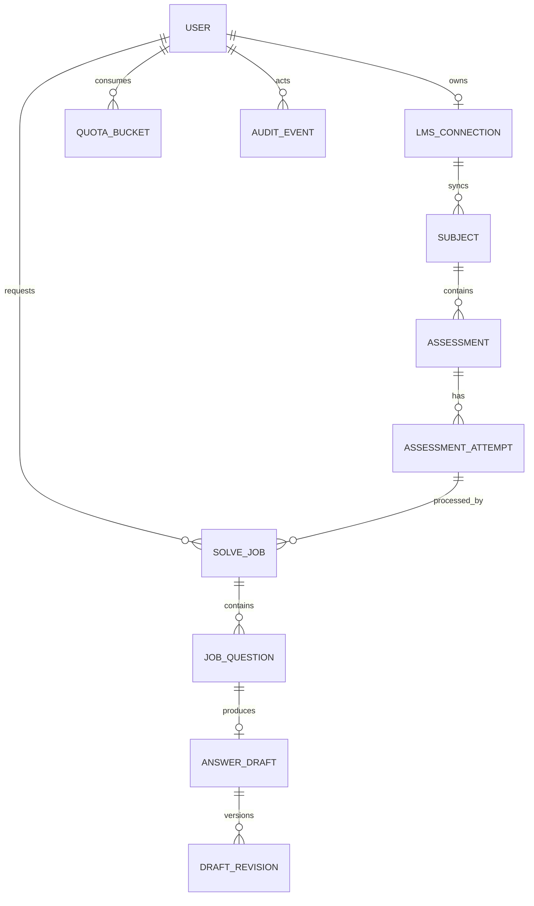

# Hallili — Detailed Database Design

**Version:** v0.1  
**Status:** Proposed relational model; confirm external identifiers and retention policy before production migrations

## 1. Design principles

1. PostgreSQL is the source of truth for user-owned data, job state, progress, and quota accounting.
2. Drizzle defines schemas and migrations; production schema changes are applied through reviewed migrations only.
3. Use UUID primary keys for Hallili records. Store LMS external identifiers as `text`, not assumed integers.
4. Use `timestamptz` for instants and UTC at the database boundary.
5. Use `jsonb` only for structured, versioned payloads that genuinely vary (normalized answer values and limited sanitized metadata). Do not use it as a substitute for relational constraints.
6. Add foreign keys, `CHECK` constraints, and unique indexes for invariants that must survive application bugs.
7. Never store plaintext LMS cookies, API keys, CSRF tokens, or full request headers.
8. Do not persist full LMS HTML by default. Store only normalized fields needed for the product and limited sanitized diagnostics.
9. Never hold a DB transaction or row lock while waiting for an external HTTP/AI request.

## 2. Naming and type conventions

| Concern | Convention |
|---|---|
| Primary keys | `uuid` generated by the application or DB |
| Foreign keys | `<entity>_id` with matching `uuid` type |
| External IDs | `text`, preserving source representation |
| Time | `timestamptz`; store UTC |
| Money/quota counts | integer/bigint or numeric where fractions are meaningful; never floating point for quota accounting |
| Confidence | `numeric(4,3)` constrained to `[0,1]` |
| Status fields | `text` plus `CHECK` constraint; easier to evolve than a PostgreSQL enum during early MVP changes |
| Structured data | `jsonb`, validated before persistence and versioned where required |
| Soft deletion | use only when restore/audit needs justify it; otherwise explicit revoke/delete plus retention policy |

## 3. Entity relationships

`USER` represents the Better Auth user record. The exact auth table names/columns are owned by the Better Auth schema and must be generated using the installed version's supported schema/migration process.

## 4. Tables

The following is the proposed logical schema. Final Drizzle column names and Better Auth integration details should be checked against the pinned package versions before writing migrations.

### 4.1 Better Auth-owned tables

**Owner:** Better Auth migrations/schema.  
**Use:** user identity, OAuth account linking, sessions, verification records.  
**Rule:** Do not hand-roll or rename Better Auth's required tables casually. Use the documented adapter/schema generation path and reference the user primary key with foreign keys from Hallili tables.

### 4.2 `lms_connections`

One default LMS connection per user in v0.1.

| Column | Type | Null? | Meaning |
|---|---|---:|---|
| `id` | uuid | no | PK |
| `user_id` | uuid | no | FK to Better Auth user; unique |
| `status` | text | no | `unverified`, `valid`, `expired`, `blocked`, `revoked`, `unknown` |
| `cookie_ciphertext` | bytea | yes | AES-GCM ciphertext only |
| `cookie_nonce` | bytea | yes | Unique 12-byte nonce/IV for each encryption |
| `cookie_auth_tag` | bytea | yes | GCM authentication tag if stored separately |
| `key_version` | integer | yes | Key version used to encrypt the credential |
| `credential_expires_at` | timestamptz | yes | Known expiry, if the LMS exposes one reliably |
| `last_validated_at` | timestamptz | yes | Last validation time |
| `last_rotated_at` | timestamptz | yes | Last persisted rotation time |
| `created_at` | timestamptz | no | Creation time |
| `updated_at` | timestamptz | no | Update time |
| `revoked_at` | timestamptz | yes | Revocation time |

**Constraints and indexes**

- `UNIQUE (user_id)`.
- `CHECK (status IN (...))`.
- Ciphertext, nonce, auth tag, and key version must either all be present or all be null.
- `status = 'revoked'` should imply encrypted credential fields are null after the revoke transaction.

**Notes**

- Do not echo the credential in API responses.
- If the credential format later includes more than one cookie, replace the single value with a versioned encrypted credential bundle; do not store arbitrary cookie headers without a reviewed scope.
- Key material lives in deployment secrets/KMS, never in this row.

### 4.3 `subjects`

| Column | Type | Null? | Meaning |
|---|---|---:|---|
| `id` | uuid | no | PK |
| `lms_connection_id` | uuid | no | FK to `lms_connections` |
| `external_subject_id` | text | no | LMS subject identifier |
| `name` | text | no | Normalized display name |
| `grade_label` | text | yes | Grade if known and needed |
| `section_label` | text | yes | Section if known and needed |
| `source_updated_at` | timestamptz | yes | LMS source timestamp if available |
| `last_synced_at` | timestamptz | no | Last successful sync |
| `created_at` | timestamptz | no | Creation time |
| `updated_at` | timestamptz | no | Update time |

**Constraints/indexes**

- `UNIQUE (lms_connection_id, external_subject_id)`.
- Index `(lms_connection_id, name)` only if subject name search is used.

### 4.4 `assessments`

| Column | Type | Null? | Meaning |
|---|---|---:|---|
| `id` | uuid | no | PK |
| `subject_id` | uuid | no | FK to `subjects` |
| `external_assessment_id` | text | no | LMS assessment identifier |
| `title` | text | no | Display title |
| `assessment_type` | text | yes | Normalized type; preserve unknown source values separately if needed |
| `due_at` | timestamptz | yes | Due date if available |
| `source_status` | text | yes | LMS-reported state, not Hallili's UI state |
| `timed_quiz_status` | text | no | `yes`, `no`, or `unknown`; default `unknown` until source confirms |
| `source_updated_at` | timestamptz | yes | LMS update timestamp if available |
| `last_synced_at` | timestamptz | no | Last successful sync |
| `safe_metadata` | jsonb | no | Allowlisted, sanitized fields only; defaults `{}` |
| `created_at` | timestamptz | no | Creation time |
| `updated_at` | timestamptz | no | Update time |

**Constraints/indexes**

- `UNIQUE (subject_id, external_assessment_id)`.
- `CHECK (timed_quiz_status IN ('yes','no','unknown'))`.
- Index `(subject_id, due_at)` for subject assessment lists.
- Do not store raw HTML in `safe_metadata`.

### 4.5 `assessment_attempts`

Represents the specific LMS quiz/result context used by the PRD's duplicate-job identity tuple.

| Column | Type | Null? | Meaning |
|---|---|---:|---|
| `id` | uuid | no | PK |
| `user_id` | uuid | no | FK to user; denormalized for ownership and uniqueness |
| `assessment_id` | uuid | no | FK to `assessments` |
| `lms_quiz_id` | text | no | External quiz identifier |
| `lms_results_id` | text | no | External result/attempt identifier |
| `timed_quiz_status` | text | no | `yes`, `no`, or `unknown`; default `unknown` |
| `source_status` | text | yes | LMS state |
| `last_seen_at` | timestamptz | no | Last source observation |
| `created_at` | timestamptz | no | Creation time |
| `updated_at` | timestamptz | no | Update time |

**Constraints/indexes**

- `UNIQUE (user_id, lms_quiz_id, lms_results_id)` — matches the PRD idempotency tuple.
- `CHECK (timed_quiz_status IN ('yes','no','unknown'))`.
- Ensure `user_id` is the owner of the LMS connection behind the assessment; enforce this in the use case and, where possible, a composite FK/unique-key design.
- Index `(assessment_id, last_seen_at DESC)`.

### 4.6 `solve_jobs`

This is both the durable job record and the PostgreSQL queue row.

| Column | Type | Null? | Meaning |
|---|---|---:|---|
| `id` | uuid | no | PK |
| `user_id` | uuid | no | FK to user / job owner |
| `attempt_id` | uuid | no | FK to `assessment_attempts` |
| `lms_quiz_id` | text | no | Denormalized external ID for active-job unique index |
| `lms_results_id` | text | no | Denormalized external ID for active-job unique index |
| `status` | text | no | `queued`, `running`, `paused`, `completed`, `failed` |
| `question_manifest_status` | text | no | `pending`, `ready`, `failed`; defaults to `pending` if questions are not known at enqueue |
| `question_manifest_loaded_at` | timestamptz | yes | When the ordered question manifest was persisted |
| `pause_reason` | text | yes | Stable typed reason, e.g. `SESSION_EXPIRED` |
| `last_error_code` | text | yes | Sanitized internal error code |
| `user_message` | text | yes | Safe actionable message; never raw provider text |
| `current_question_position` | integer | yes | 1-based position currently being processed |
| `total_questions` | integer | no | Defaults 0 until extracted |
| `completed_questions` | integer | no | Defaults 0 |
| `attempt_count` | integer | no | Number of worker claims/attempts |
| `max_attempts` | integer | no | Configured upper bound copied at creation |
| `available_at` | timestamptz | no | Earliest eligible claim/retry time |
| `locked_by` | text | yes | Worker process ID |
| `lease_expires_at` | timestamptz | yes | Lease expiry |
| `heartbeat_at` | timestamptz | yes | Last worker heartbeat |
| `idempotency_key` | text | yes | Client request idempotency key or generated key |
| `created_at` | timestamptz | no | Creation time |
| `started_at` | timestamptz | yes | First start |
| `finished_at` | timestamptz | yes | Terminal completion/failure time |
| `updated_at` | timestamptz | no | Last update |

**Constraints/indexes**

- `CHECK (status IN ('queued','running','paused','completed','failed'))`.
- `CHECK (question_manifest_status IN ('pending','ready','failed'))`.
- `CHECK (total_questions >= 0 AND completed_questions >= 0 AND completed_questions <= total_questions)`.
- `CHECK (attempt_count >= 0 AND max_attempts > 0)`.
- Active-job partial unique index: `UNIQUE (user_id, lms_quiz_id, lms_results_id) WHERE status IN ('queued','running','paused')`.
- Queue claim index: `(available_at, created_at)` with partial predicate `status = 'queued'`.
- Owner listing index: `(user_id, created_at DESC)`.
- Lease recovery index: `(lease_expires_at)` with partial predicate `status = 'running'`.

**Question manifest note**

The queue row may be inserted before question details are known. If the external question manifest is not already available from a prior approved read, the Worker loads and validates the manifest after claiming the job, then persists all ordered `job_questions` and sets `question_manifest_status = 'ready'` in one short transaction. This is an explicit detail to reconcile with the System Design statement about inserting initial question rows with the job; see `OPEN_DECISIONS.md` OD-24. Do not fetch the LMS from the enqueue request merely to preserve a diagram if that would violate the sub-300ms target.

**State semantics**

- `queued`: eligible now or at `available_at`.
- `running`: currently held by a Worker lease.
- `paused`: safe stop requiring a blocker to be addressed or an explicit retry.
- `completed`: every required question has a durable draft outcome.
- `failed`: terminal unrecoverable state; retry must be an explicit permitted transition, not an arbitrary status update.

### 4.7 `job_questions`

| Column | Type | Null? | Meaning |
|---|---|---:|---|
| `id` | uuid | no | PK |
| `job_id` | uuid | no | FK to `solve_jobs` |
| `external_question_id` | text | yes | LMS question identifier, when available |
| `position` | integer | no | 1-based order in the attempt |
| `question_type` | text | yes | Normalized type |
| `status` | text | no | `pending`, `processing`, `draft_saved`, `manual_input_required`, `failed`, `skipped` |
| `pause_reason` | text | yes | Question-level typed blocker if applicable |
| `question_fingerprint` | text | yes | Stable hash used only if external ID is absent and safe identity can be established |
| `normalized_question` | jsonb | yes | Minimal normalized snapshot; retention and encryption policy required if it contains sensitive content |
| `parser_version` | text | yes | Parser version used to normalize the source |
| `started_at` | timestamptz | yes | Processing start |
| `completed_at` | timestamptz | yes | Durable outcome time |
| `created_at` | timestamptz | no | Creation time |
| `updated_at` | timestamptz | no | Last update |

**Constraints/indexes**

- Require at least one stable identity: `external_question_id IS NOT NULL OR question_fingerprint IS NOT NULL`; if neither is available, pause before creating resumable question work.
- Partial unique index `(job_id, external_question_id) WHERE external_question_id IS NOT NULL`.
- Partial unique index `(job_id, question_fingerprint) WHERE question_fingerprint IS NOT NULL`.
- `UNIQUE (job_id, position)`.
- `CHECK (position > 0)`.
- Index `(job_id, position)` to read questions in order.
- Index `(job_id, status)` for pending work lookup.

If the LMS does not expose stable question IDs, do not invent them from display text alone. Define a tested fingerprint strategy and record its limitations before enabling resume across source changes.

### 4.8 `answer_drafts`

One current draft per `job_questions` row.

| Column | Type | Null? | Meaning |
|---|---|---:|---|
| `id` | uuid | no | PK |
| `job_question_id` | uuid | no | FK to `job_questions`; unique |
| `answer_payload` | jsonb | no | Current structured answer, validated for question type |
| `explanation` | text | yes | Explanation shown for review; retention policy applies |
| `confidence` | numeric(4,3) | yes | Model-reported score; not proof of correctness |
| `remote_save_status` | text | no | `not_enabled`, `not_started`, `pending`, `saved`, `ambiguous`, `failed`; defaults to `not_enabled` |
| `external_draft_id` | text | yes | LMS draft reference, only if remote draft saving is approved and enabled |
| `origin` | text | no | `ai_generated`, `user_entered`, `edited` |
| `version` | integer | no | Starts at 1; optimistic concurrency version |
| `reviewed_at` | timestamptz | yes | When the user reviewed it |
| `updated_by_user_id` | uuid | yes | Last editor |
| `created_at` | timestamptz | no | Creation time |
| `updated_at` | timestamptz | no | Last update |

**Constraints/indexes**

- `UNIQUE (job_question_id)`.
- `CHECK (confidence IS NULL OR (confidence >= 0 AND confidence <= 1))`.
- `CHECK (version > 0)`.
- `CHECK (remote_save_status IN ('not_enabled','not_started','pending','saved','ambiguous','failed'))`.

When remote draft saving is disabled, `remote_save_status` remains `not_enabled`. A timeout after an approved remote write is `ambiguous` until a reconciliation read determines the remote outcome; it must not be marked failed and blindly retried.

### 4.9 `draft_revisions`

Append-only history for generated and edited draft versions where FR-09 review history is retained.

| Column | Type | Null? | Meaning |
|---|---|---:|---|
| `id` | uuid | no | PK |
| `draft_id` | uuid | no | FK to `answer_drafts` |
| `version` | integer | no | Version number |
| `answer_payload` | jsonb | no | Versioned answer |
| `actor_type` | text | no | `system` or `user` |
| `actor_user_id` | uuid | yes | User editor when applicable |
| `change_reason` | text | yes | Safe short reason; no secrets |
| `created_at` | timestamptz | no | Revision time |

**Constraints/indexes**

- `UNIQUE (draft_id, version)`.
- Index `(draft_id, created_at)`.
- Retain only for the approved history period; draft content may include student work and must not be kept indefinitely by default.

### 4.10 `quota_buckets`

Current aggregate accounting bucket for one user, metric, and quota period.

| Column | Type | Null? | Meaning |
|---|---|---:|---|
| `id` | uuid | no | PK |
| `user_id` | uuid | no | FK to user |
| `metric` | text | no | e.g. `assessment` or `question` |
| `period_start` | timestamptz | no | Inclusive period start |
| `period_end` | timestamptz | no | Exclusive period end |
| `limit_units` | bigint | no | Current configured limit |
| `reserved_units` | bigint | no | Units reserved but not yet consumed/released |
| `consumed_units` | bigint | no | Units consumed in the period |
| `updated_at` | timestamptz | no | Last update |

**Constraints/indexes**

- `UNIQUE (user_id, metric, period_start)`.
- `CHECK (limit_units >= 0 AND reserved_units >= 0 AND consumed_units >= 0)`.
- `CHECK (period_end > period_start)`.
- Reservation must ensure `consumed_units + reserved_units + requested_units <= limit_units` under a row lock.

### 4.11 `quota_events`

Idempotent ledger of quota mutations.

| Column | Type | Null? | Meaning |
|---|---|---:|---|
| `id` | uuid | no | PK |
| `bucket_id` | uuid | no | FK to `quota_buckets` |
| `user_id` | uuid | no | FK to user |
| `reference_type` | text | no | `solve_job`, `job_question`, or other approved source |
| `reference_id` | uuid | no | Source record |
| `event_type` | text | no | `reserve`, `consume`, `release`, `adjust` |
| `units` | bigint | no | Positive units affected; direction determined by event type |
| `idempotency_key` | text | no | Unique logical event key |
| `created_at` | timestamptz | no | Event time |

**Constraints/indexes**

- `UNIQUE (user_id, idempotency_key)`.
- `CHECK (units > 0)`.
- Index `(user_id, created_at DESC)` for usage history.

### 4.12 `lms_account_leases`

A distributed lease preventing concurrent operations from racing a shared rotating LMS session.

| Column | Type | Null? | Meaning |
|---|---|---:|---|
| `lms_connection_id` | uuid | no | PK/FK to `lms_connections` |
| `owner_token` | uuid | no | Random lease ownership token |
| `worker_id` | text | no | Current process identifier |
| `lease_expires_at` | timestamptz | no | Lease expiry |
| `heartbeat_at` | timestamptz | no | Last extension |
| `updated_at` | timestamptz | no | Last update |

Use compare-and-set/transactional lease acquisition. An expired lease may be replaced; a live lease may not be stolen. Release must match `owner_token` so an old worker cannot release a newer worker's lease.

### 4.13 `integration_rate_limit_state`

Shared coordination state for the global approved LMS outbound limit.

| Column | Type | Null? | Meaning |
|---|---|---:|---|
| `bucket_key` | text | no | PK, e.g. approved host + route class |
| `tokens` | numeric(12,4) | no | Current token-bucket balance |
| `updated_at` | timestamptz | no | Last refill/update |
| `blocked_until` | timestamptz | yes | Respect server-provided Retry-After or operator pause |

Rate values are configuration, not hardcoded assumptions in the schema. This state coordinates polite load protection across all Worker processes. It must never be used to bypass `403`, WAF, explicit blocks, or published limits.

### 4.14 `audit_events`

| Column | Type | Null? | Meaning |
|---|---|---:|---|
| `id` | uuid | no | PK |
| `actor_user_id` | uuid | yes | Null after approved anonymization/deletion where policy requires |
| `actor_type` | text | no | `user`, `system`, `operator` |
| `action` | text | no | Stable action name |
| `target_type` | text | no | Target entity category |
| `target_id` | uuid | yes | Target record identifier |
| `request_id` | text | yes | Correlation ID |
| `safe_metadata` | jsonb | no | Allowlisted metadata only; defaults `{}` |
| `created_at` | timestamptz | no | Event time |

Never include credential values, OAuth tokens, CSRF tokens, raw headers, or unredacted external responses in metadata.

### 4.15 Optional tables

- `notifications`: user-owned in-app notification records. Add only when FR-10 is scheduled.
- `submission_records`: **not part of enabled v0.1**. Add only after written authorization for a final action. Its storage and DB privileges must be separated from Worker writes.

## 5. Index and constraint checklist

Before the first production migration, verify at least:

| Table | Constraint/index |
|---|---|
| `lms_connections` | Unique `user_id`; credential fields all-null/all-present check |
| `subjects` | Unique `(lms_connection_id, external_subject_id)` |
| `assessments` | Unique `(subject_id, external_assessment_id)`; `(subject_id, due_at)` |
| `assessment_attempts` | Unique `(user_id, lms_quiz_id, lms_results_id)` |
| `solve_jobs` | Active tuple partial unique index; queued claim index; owner listing index; running lease index |
| `job_questions` | Unique `(job_id, position)`; unique external ID per job when non-null; `(job_id, status)` |
| `answer_drafts` | Unique `job_question_id`; version/confidence checks |
| `draft_revisions` | Unique `(draft_id, version)` |
| `quota_buckets` | Unique `(user_id, metric, period_start)`; non-negative units |
| `quota_events` | Unique `(user_id, idempotency_key)` |
| `lms_account_leases` | PK on connection ID; lease expiry index if sweeper/query requires it |

Partial indexes can be expressed in Drizzle's PostgreSQL index API using a `where` predicate; verify generated SQL in migration review rather than assuming the TypeScript declaration is correct.

## 6. Transaction boundaries

### 6.1 Create solve job

One short transaction:

1. Verify the actor owns every selected attempt.
2. Read/check the active-job unique tuple.
3. Lock the relevant quota bucket row(s).
4. If allowed, reserve the agreed assessment quota units and insert corresponding `quota_events` idempotently.
5. Insert the `solve_jobs` row(s) in `queued` state with `available_at = now()`.
6. Commit and return the IDs.

If a partial unique conflict occurs due to a concurrent request, return the existing active job for that tuple and do not reserve quota twice. The transaction must be safe under retries.

### 6.2 Claim a queue job

One short transaction:

1. Select an eligible queued row with `FOR UPDATE SKIP LOCKED`.
2. Check/acquire the account-session lease if the operation requires the shared LMS session.
3. Set `status = 'running'`, `locked_by`, `lease_expires_at`, `heartbeat_at`, and increment `attempt_count`.
4. Commit.

Do not leave row locks open while making network requests.

### 6.3 Process one question

- Fetch source data outside a transaction.
- Validate normalized question data.
- Call AI outside a transaction.
- Validate the response against the question schema and allowed choices.
- If remote LMS draft persistence is enabled, execute it only through the gated adapter and reconcile ambiguous outcomes before retrying.
- In a short transaction, upsert the local `answer_drafts` row, append a `draft_revisions` record, mark the question durably complete, update job progress, and consume the appropriate reserved quota units idempotently.

### 6.4 Pause/resume

- Pause transaction persists `status = 'paused'`, typed reason, safe message, clears/invalidates the current lease as appropriate, and preserves completed question rows.
- Resume transaction verifies ownership, `status = 'paused'`, blocker resolution, quota availability if more work is reserved, then sets `status = 'queued'`, clears pause fields, and sets `available_at = now()`.
- The browser cannot update `status` directly.

### 6.5 Update a draft

One transaction:

1. Fetch the draft scoped to the authenticated owner.
2. Compare `version` with `expectedVersion`.
3. If mismatched, return conflict without writing.
4. Update `answer_payload`, increment version, update actor/time.
5. Insert `draft_revisions`.
6. Write an audit event if required by the retention policy.

### 6.6 Update/revoke an LMS credential

- Validate request shape and origin/CSRF protections.
- Encrypt before DB persistence; persist ciphertext, nonce, auth tag, key version.
- Never persist plaintext in a temporary table or log.
- On revoke, clear encrypted material and invalidate any session leases/jobs according to the approved product policy.

## 7. Deletion and retention policy

The exact durations are unresolved and must be approved before launch. The implementation must support these categories separately:

| Data | Required policy decision |
|---|---|
| LMS credentials | Revoke immediately on user action; wipe on account deletion; key rotation procedure |
| Session/CSRF values | Never persist separately in plaintext; keep only in memory as required |
| Normalized question content | Minimize fields; define short retention and deletion behavior |
| AI draft and revision content | Define user-visible history period and account-deletion behavior |
| Job progress | Retain enough to support active jobs and agreed history; purge old terminal jobs |
| Quota ledger | Keep minimum records needed for abuse/accounting audit; define anonymization |
| Security audit events | Define restricted access and retention; avoid content/secrets |
| Operational logs | Short retention; no credential or full question content |

**Account deletion must be a coordinated use case, not an unreviewed cascade.** It should revoke the LMS connection, stop/revoke active jobs safely, delete or anonymize user content per policy, and handle Better Auth records consistently.

## 8. Encryption requirements

For AES-256-GCM:

- use a 32-byte key from a deployment secret manager/KMS;
- generate a cryptographically random 12-byte nonce for each encryption;
- store nonce, ciphertext, auth tag, and `key_version`;
- use AAD that binds ciphertext to `lms_connection_id` and `user_id`;
- verify the authentication tag before returning plaintext;
- rotate keys through a versioned decrypt/re-encrypt migration path;
- keep plaintext in memory only as long as needed and never serialize it to logs/traces/errors;
- do not place the key in the same database as ciphertext.

## 9. Queue and concurrency details

- `solve_jobs` is the durable queue table; no Redis/BullMQ is required for v0.1.
- Multiple Workers may claim different jobs through `SKIP LOCKED`.
- Questions within one attempt execute sequentially.
- Jobs sharing one rotating LMS account/session must be serialized through `lms_account_leases` unless integration testing proves concurrent use safe.
- The global outbound limiter is shared across Worker instances using database coordination, not an in-memory counter.
- Worker leases need heartbeat and stale-lease recovery; the recovery process must never assume an in-flight external write failed.
- If an external draft save times out, reconcile remote state before another write. Local database idempotency does not make a remote side effect idempotent automatically.

## 10. Migration checklist

- [ ] Generate Better Auth schema using the pinned Better Auth version.
- [ ] Create domain tables in dependency order with FK delete behavior reviewed.
- [ ] Create all unique, partial, and query indexes.
- [ ] Add state/value `CHECK` constraints.
- [ ] Test migrations against a clean PostgreSQL database.
- [ ] Test migration upgrade from previous schema version.
- [ ] Test concurrent duplicate job creation.
- [ ] Test concurrent quota reservation.
- [ ] Test concurrent queue claiming and lease recovery.
- [ ] Confirm retention and account-deletion behavior before production data is stored.

