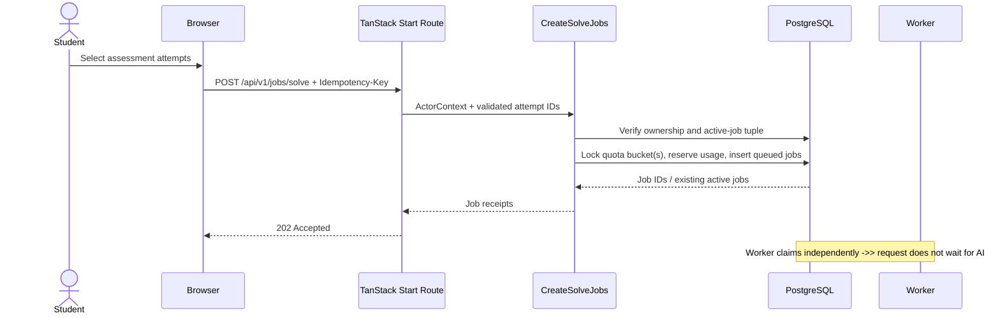
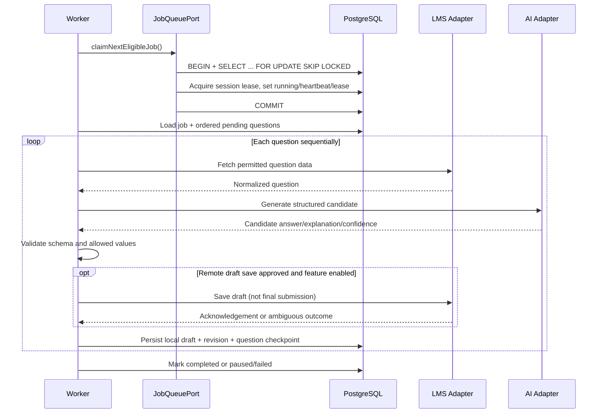

# Hallili — Detailed Runtime Flows

**Version:** v0.1  
**Status:** Proposed operational behavior

## 1. Purpose and conventions

This document expands the System Design scenarios into explicit steps, ownership checks, transaction boundaries, failure paths, and invariants. It is a runtime contract for implementers and testers.

- **Web** means a Tanstack Start Server Route or SSR loader.
- **Application** means an Application use case.
- **Worker** means the independent Node.js queue consumer.
- **LMS Adapter** means the approved external integration adapter. Use a fake adapter until permission and protocol details are confirmed.
- **Local draft** means an answer stored in Hallili for review. It is not automatically a remote LMS draft and is never a final submission.

## 2. Flow A — Sign in and create an LMS connection

### Preconditions

- Student has an allowed Microsoft account type according to the identity policy.
- User is authenticated in Hallili.
- LMS credential entry is enabled only after the integration method and data handling are approved.

### Steps

1. Browser starts Microsoft sign-in through Better Auth.
2. Better Auth handles the OAuth/OIDC flow and creates the Hallili session.
3. On a protected page, Web resolves the session and creates `ActorContext`.
4. Student submits the LMS credential through HTTPS.
5. Web enforces origin/CSRF protection, request body size, and strict request schema; request logging excludes the body.
6. `SaveLmsCredential` validates the actor and encrypts the credential through `CredentialCipher`.
7. In a short DB transaction, insert/update `lms_connections` with ciphertext, nonce, auth tag, and key version.
8. Return connection metadata only; do not echo the submitted secret.
9. Student explicitly starts validation. `ValidateLmsConnection` calls only the approved LMS validation operation.
10. Map the response into `valid`, `expired`, `blocked`, or `unknown`; persist status and validation time.

### Failure paths

| Failure                    | Behavior                                                      |
| -------------------------- | ------------------------------------------------------------- |
| No Hallili session         | 401; no credential processing                                 |
| Invalid request/origin     | 400/403; do not persist                                       |
| Encryption failure         | 503/500 safe code; no plaintext fallback                      |
| LMS login/expired response | mark `expired`; show update action                            |
| LMS 403/explicit block     | mark `blocked`; stop; do not retry through another route/host |
| Unexpected redirect/host   | reject; never forward cookie to the new host                  |
| Parser/response unknown    | `unknown` or `PARSER_MISMATCH`; sanitized diagnostic          |

### Invariants

- Credential values never appear in response, logs, traces, analytics, or error messages.
- A user can only update/revoke their own connection.
- Decrypted value exists only in the server-side execution boundary for the minimum required time.

## 3. Flow B — Refresh subjects and due assessments

### Preconditions

- Actor authenticated and owns a valid LMS connection.
- Read operation is explicitly allowed by the LMS/school and is implemented in the LMS adapter.

### Subject refresh

1. `POST /api/v1/subjects/refresh` authenticates actor.
2. `RefreshSubjects` loads the actor's own connection metadata.
3. Decrypt credential only in the adapter execution boundary.
4. Make the approved request to the fixed allowlisted host; apply timeout, response size limits, and shared rate limiter.
5. Parse SSR HTML or documented API response into a typed normalized subject list.
6. If the structure is unknown or validation fails, persist no guessed records; return a safe parser error and store sanitized diagnostics.
7. In a short transaction, upsert by `(lms_connection_id, external_subject_id)` and update `last_synced_at`.
8. Return count and refresh time.

### Assessment refresh

The subject-specific refresh follows the same steps, scoped to one owned subject and a bounded source page/request. Normalize `due_at`, source status, and `timed_quiz_status` (`yes | no | unknown`). Unknown timed status must not be silently treated as `no`; use `yes | no | unknown`, and default-deny when status is not explicitly `no`.

### Failure paths

- Expired credential → mark connection expired; no catalog guess; user must update it.
- 429/Retry-After → honor it and show/queue a retry according to the endpoint's bounded policy.
- 403/explicit platform block → stop the integration.
- HTML/parser change → `PARSER_MISMATCH`; no empty/guessed fields saved.
- Timeout > configured page budget → bounded retry only where safe, otherwise return a retryable error.

## 4. Flow C — Create one or more solve jobs

### Steps

1. Browser sends attempt IDs and `Idempotency-Key`.
2. Web authenticates the actor, validates body and request key, and rejects malformed/oversized input.
3. `CreateSolveJobs` loads all attempts scoped to `ActorContext.userId`; missing/foreign attempts return a non-disclosing not-found response.
4. Domain policy checks attempt status and timed-assessment policy. Default policy denies timed work unless both the required external policy approval and a separate runtime configuration are present; user acknowledgement alone is insufficient.
5. Start one short transaction for the selected attempt set.
6. For each attempt, check active-job uniqueness. If an active job exists, include that job as `existing` and do not reserve quota again.
7. For each new job, lock the required quota bucket rows and reserve the approved quota units.
8. Insert `solve_jobs` rows in `queued` state with `available_at = now()` and stable external tuple.
9. Commit and return `202 Accepted` with job IDs.
10. Worker polls/claims independently.

### Failure paths

- Quota exceeded → rollback all or apply a documented all-or-nothing/partial-create policy. Choose one policy before coding; recommendation is all-or-nothing for one request to keep user expectations clear.
- Duplicate concurrent create requests → DB partial unique index wins; return the existing job and do not double-reserve quota.
- DB unavailable → 503; no job is claimed as created unless transaction committed.
- Worker not running → job remains queued; Web response remains fast and user sees queued state.

### Invariants

- `POST` does not call AI or solve an assessment inline.
- Duplicate active jobs for the same external tuple are prevented at both application and database levels.
- Quota reservation and new job insertion are atomic.

## 5. Flow D — Worker claims and executes a job

### Claim steps

1. Worker is healthy and has capacity.
2. Queue adapter opens a short transaction.
3. Select an eligible `queued` job where `available_at <= now()` using `FOR UPDATE SKIP LOCKED`.
4. Acquire the `lms_account_leases` row for the associated connection. If a live lease exists, do not process another job using that same rotating session; defer it safely.
5. Set job status to `running`, worker ID, lease expiry, heartbeat, and increment attempt count.
6. Commit. All external network work happens after commit.

### Question-manifest initialization and per-question steps

1. If `question_manifest_status = pending`, retrieve the authorized question manifest for the attempt after the Worker has claimed the job.
2. Normalize question order, supported type, and stable external question identity. If no safe identity can be established, pause with `PARSER_MISMATCH`.
3. In a short transaction, insert the ordered `job_questions` set, set `total_questions`, and mark the manifest `ready`. This is a design detail that must be reconciled with the System Design instruction to create initial question rows in the enqueue transaction; see OD-24.
4. Load question rows ordered by `position`.
5. Skip questions with durable `draft_saved` outcomes; do not repeat them on resume.
6. Fetch each question via the fixed/approved LMS integration boundary if the manifest did not already include the full normalized question.
7. Normalize and validate question type, choices, required fields, and stable external identity.
8. If parser confidence/shape is not sufficient, pause with `PARSER_MISMATCH`; never guess.
9. Call `AiDraftGenerationPort` with only the needed question content and configured language/model policy. AI has no arbitrary browser, LMS, or network tools.
10. Validate returned JSON against a strict schema and validate selected options against the allowed values extracted from the source.
11. If invalid, allow only a bounded schema-correction retry if configured. Reject out-of-range or fabricated option IDs.
12. Save a local draft in Hallili.
13. If and only if `LmsDraftPort` is enabled after the external policy gate, save a remote draft using the approved method. This operation is not the final submission capability.
14. If remote save times out, mark the outcome ambiguous and reconcile remote state before retrying. Do not repeat the write blindly.
15. In a short transaction, persist draft/revision, mark question outcome durable, update job progress, and consume relevant quota idempotently.
16. Continue to next question only after the durable checkpoint succeeds.

### End states

- All required questions durable → `completed`.
- Known blocker → `paused` with typed reason.
- Recoverable provider outage → set `available_at` with backoff and requeue, or pause after configured exhaustion; never busy-loop.
- Unrecoverable internal/data integrity failure → `failed` with stable safe error code and operator diagnostics.

## 6. Flow E — AI retry and fallback

1. Adapter classifies provider failure into timeout, 429, 503, permanent auth/configuration error, invalid response, or unknown.
2. For 429/503, honor `Retry-After` when present; otherwise use bounded exponential backoff with jitter.
3. Switch to a configured fallback model only if the failure is eligible and the fallback policy allows it.
4. Keep model/provider selection in configuration; domain code does not know provider SDK types.
5. Record sanitized provider alias, attempt number, duration, and outcome—not API key or raw prompt by default.
6. After maximum attempts or exhausted fallbacks, pause/fail with `PROVIDER_UNAVAILABLE` or a typed error; keep completed question checkpoints.

Do not retry permanent authorization errors with a different provider and do not allow unbounded retries.

## 7. Flow F — Pause and resume

### Pause

1. Worker detects a blocker: session expired, manual input required, parser mismatch, policy denied, or repeated provider outage.
2. Persist any already-completed question result first.
3. Transition the job to `paused`, persist `pause_reason` and safe `user_message`, clear or let the active lease expire safely, and retain progress.
4. UI polling observes `paused` and displays the specific next action.

### Resume

1. User resolves the blocker (for example, updates the LMS connection) and presses Resume.
2. `POST /api/v1/jobs/:jobId/resume` authenticates and checks ownership.
3. Use case verifies state `paused`, validates the relevant blocker resolution, and checks quota.
4. In a short transaction, move job to `queued`, clear pause/error fields that are resolved, and set `available_at = now()`.
5. Return `202`; Worker claims it later.
6. Worker reloads durable question state, skips completed questions, and revalidates the blocker before continuing.

The browser must never set `running` directly. A paused job must not resume merely because the credential changed; the user must request resume.

## 8. Flow G — Worker crash and stale lease recovery

1. Worker crashes or loses DB connectivity while processing.
2. Heartbeat stops; job and/or account lease expires.
3. Recovery logic identifies stale `running` jobs after `lease_expires_at`.
4. Before requeueing, inspect the current question checkpoint and any in-flight remote-write marker.
5. If no ambiguous external side effect exists, set job to `queued` with `available_at = now()`; new Worker claims later.
6. If a remote draft write may have succeeded, mark it as requiring reconciliation; do not repeat it blindly.
7. New Worker skips durable completed questions and resumes from the first incomplete question.

A lease is a recovery mechanism, not proof that a remote request did not happen.

## 9. Flow H — Review and edit a local draft

1. Browser reads job/questions through owner-scoped endpoints.
2. Review UI presents source question, proposed answer, explanation, and model-reported confidence with a clear reminder that confidence is not correctness.
3. User edits an answer.
4. Browser sends `PATCH /api/v1/drafts/:draftId` with `expectedVersion`.
5. Application verifies ownership, validates answer against the known question type/options, and checks version.
6. In one DB transaction, update current draft, increment version, append revision, and optionally add audit event.
7. Return the latest draft DTO.
8. If version conflict, return `409 VERSION_CONFLICT`; client reloads current revision and asks user to reconcile their edit.
9. A local edit does not automatically write to the LMS. A remote draft-save status, when that gated feature is enabled, is tracked separately from local draft readiness; `ambiguous` requires reconciliation before retry.

## 10. Flow I — UI progress synchronization

- Initial dashboard data can be loaded through SSR route loaders or read endpoints.
- TanStack Query polls job status only while status is `queued` or `running`.
- Poll interval is configurable and can slow with many active jobs; avoid one request per question on every tick.
- When `paused`, stop active polling and present the blocker; when terminal, stop polling.
- If browser closes or client loses connectivity, Worker continues because its state is in PostgreSQL.
- On return, UI fetches latest state from DB through API.
- Polling never carries session secrets or raw upstream data.

## 11. Flow J — Timed assessments and policy gates

- Default behavior is deny for `timed_quiz_status = yes` or `unknown`. Only an explicit `no` is treated as non-timed.
- A user acknowledgement is a product UX signal only; it is not evidence that the operation is permitted.
- Enable only after a documented policy decision confirms the use case is allowed and the feature flag is explicitly configured.
- If not enabled, create no solve job and return `POLICY_BLOCKED` with a safe explanation.

## 12. Flow K — Final action boundary

There is no active final-submission flow in v0.1 implementation. If the feature is approved later:

1. User reviews the exact current draft versions.
2. Web requires fresh authentication/confirmation bound to those versions and the exact attempt.
3. Submission use case performs final ownership/policy checks and an idempotency check.
4. A dedicated Web-only adapter performs the explicitly authorized operation.
5. Persist result and audit record.
6. Worker package, Worker DB role, and Worker composition root have no final-action import or privilege.

If authorization is absent or ambiguous, do not implement or enable this flow. Local draft completion must not be mislabeled as LMS submission.

## 13. Cross-flow invariants

- All user-owned resources are owner-scoped in Application use cases.
- Job transitions occur through a domain transition policy, never arbitrary DB status updates from routes.
- No DB transaction spans an external network call.
- Completed question work is durable before moving forward.
- AI output is untrusted until validated against source-derived constraints.
- No guessed answer, option, external ID, or source state is persisted.
- Session cookies and CSRF values are redacted everywhere.
- Worker cannot perform a final action.
- Explicit external blocks are respected, not bypassed.
